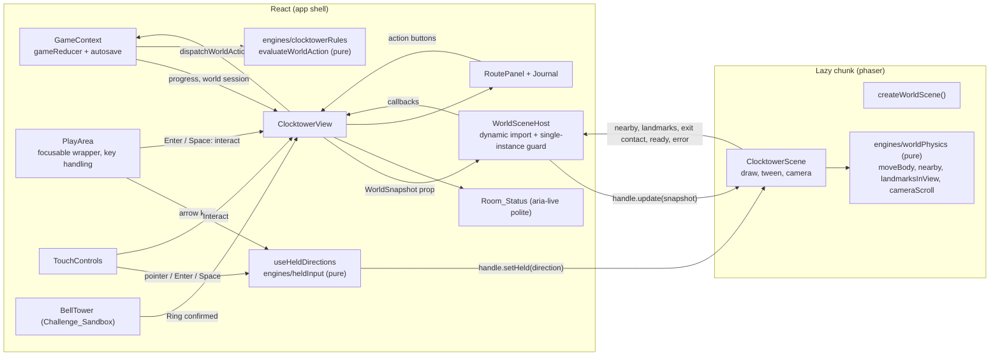
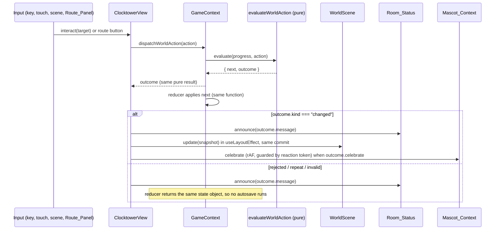
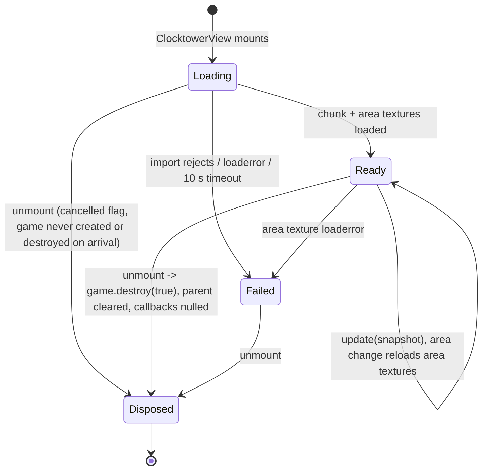
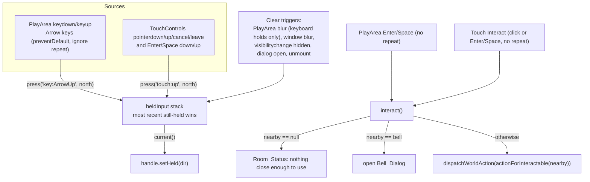
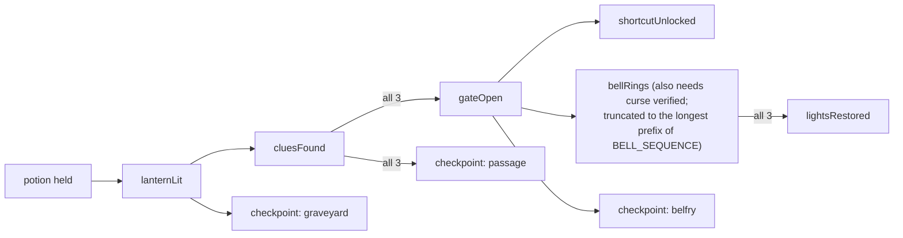

# Design Document: Clocktower Gate (Adventure Phase 3)

## Overview

Clocktower Gate adds room 3: a scrolling, top-down Phaser overworld that runs from the
Apothecary Exit to the Belfry, ending in a live focus repair on a bell confirmation dialog.
This design follows the requirements in `requirements.md` and the four build checkpoints in
`.kiro/skills/keyquest-room-slice/references/clocktower-pilot.md`.

The design rests on one rule: **React owns every decision, Phaser only draws and moves.**
Progress, objectives, available actions, Room_Status text, focus, and saving live in React
(`GameContext` and `ClocktowerView`). The Phaser scene receives a `WorldSnapshot` and reports
what the Ghost touches. Every quest step is a typed `WorldAction` that keyboard, touch, the
Route_Panel, and the scene all dispatch through one pure function. Collision, held-input
order, camera placement, and landmark visibility are pure modules too, so the Vitest suite
covers them in jsdom without loading Phaser.

Detail levels match the requirements:

| Checkpoint | Requirements | Detail in this design |
|---|---|---|
| 1. Animated courtyard | 1 to 12 | Full: map numbers, input model, scene lifecycle, preview entry |
| 2. Complete route | 13 to 18 | Area list, data shapes, save schema, publishing. Map coordinates are set during the task. |
| 3. Live repair | 19 to 22 | Sandbox markup, dialog mechanism, repair, verification, Escape handling |
| 4. Motion pass | 23 | Tween catalog and the rules that keep state ahead of animation |

### Research findings that shape the design

- **Phaser version.** The current stable release is Phaser v4.2.1, released 9 July 2026
  ([phaser.io download page](https://phaser.io/download/stable)). The dependency is
  `phaser@^4.2.1`.
- **ESM import.** v4.1.0 fixed the ESM build so `import Phaser from 'phaser'` has a default
  export, and the ESM build does not set `window.Phaser`
  ([v4.1.0 release notes](https://phaser.io/news/2026/04/phaser-4-1-0-salusa-release)). The
  scene module uses the default import inside a dynamically imported file.
- **Renderer.** Phaser 4 replaced the WebGL pipeline with render nodes. The Canvas renderer
  still exists but is deprecated, and masks and FX became WebGL filters
  ([v4 migration guide](https://github.com/phaserjs/phaser/blob/master/changelog/v4/4.0/MIGRATION-GUIDE.md)).
  Headless Chromium may not provide WebGL, so the game uses `Phaser.AUTO` and draws only with
  features both renderers support: images, tilemap layers, canvas textures, alpha, scale,
  rotation, and position tweens. No filters, masks, or custom render nodes.
- **Existing lazy-load precedent.** `riveRuntimeLoader.ts` already caches a dynamic
  `import('@keyquest/rive-canvas')`. The Phaser loader follows the same pattern.
- **fast-check is not installed.** Add it as a devDependency if an optional property-based
  task is selected. The required courtyard tests use the existing Vitest and Playwright tools.
- **The hint keeper is never drawn.** `HintPanel` already calls
  `triggerHintKeeper('requestAttention')`, but no view renders a `RiveMascot` bound to
  `hintKeeperSignal`. Requirement 23.6 needs a visible Lantern Search, so the Clocktower hint
  area mounts a hint keeper medallion (see Open questions, decision 9).
- **Asset sizes** (read from the PNG headers in `public/adventure/`): Ghost directions
  128 × 128; tiles 48 × 48; `lantern-post.png` 101 × 210; `stone-well.png` 133 × 162;
  `yew-tree.png` 210 × 212; `wall-horizontal.png` 218 × 85; `wall-vertical.png` 74 × 179;
  `wall-corner.png` 169 × 162; `wall-post.png` 95 × 137; clue plaques about 151 × 158;
  gates 512 × 320; windows, bell, and lantern 384 × 384; `bell-chamber.png` 1152 × 768. The
  Courtyard set (player, cobbles, walls, lantern post, well, yew) is about 1.3 MB; the full
  set is about 8 MB, so assets load per Area.

## Architecture

### React and Phaser boundary



Rules for the boundary:

1. `ClocktowerView` is the only component that dispatches `WorldAction`s. The scene never sees
   `dispatch`.
2. The scene receives state only through `handle.update(snapshot)` and movement only through
   `handle.setHeld(direction | null)`. It reports facts (nearby Interactable changed, landmarks
   in view changed, exit contact began, exit entered, ready, load error) and never decides
   whether an action succeeds.
3. Only files under `src/components/WorldScene/phaser/` may import `phaser`. An ESLint
   `no-restricted-imports` override enforces this, and a unit test mocks `phaser` to throw on
   import while loading every other Clocktower module (Requirement 24.13).
4. Pure modules (`clocktowerRules`, `worldPhysics`, `heldInput`, `clocktowerRoute`) import
   nothing from React, the DOM, or Phaser.

### World_Action flow



`dispatchWorldAction` calls the same pure `evaluateWorldAction` that the reducer calls, so the
message the view announces and the state the reducer stores always agree (Requirements 2.3,
2.5, 3.2). React 19 flushes discrete events (key, pointer, click) synchronously, so each input
event evaluates against the latest committed progress.

### Scene lifecycle



`WorldSceneHost` guards against React StrictMode's double mount and against remounts:

- Each effect run takes a new `generation` number. When the dynamic import or the asset load
  resolves, the host creates or keeps the game only if its generation is still current.
- A module-level `activeHandle` in `WorldSceneHost.tsx` holds the live handle. Creating a new
  scene first destroys any previous handle, so at most one game exists (Requirement 2.9).
- Cleanup sets `cancelled`, replaces the callback object with no-ops, calls
  `game.destroy(true)`, and calls `parent.replaceChildren()` at once. Phaser finishes its own
  teardown on its next step, but the canvas leaves the document synchronously and no callback
  can reach React afterwards (Requirement 2.8).
- A 10-second timer starts on mount. If the scene is not ready when it fires, the host marks
  the scene failed and destroys a game that arrives later (Requirement 2.11).

## Components and Interfaces

### Module layout

Placement follows `structure.md`: static data in `registry/`, rules in `engines/`, types in
`types/`, rendering in `components/` and `views/`.

| File | New or changed | Responsibility |
|---|---|---|
| `src/types/clocktower.ts` | New | `AreaId`, `ClueId`, `BellId`, `Direction`, `Rect`, Route_Data types, `ClocktowerState`, `WorldAction`, `WorldOutcome`, `WorldSnapshot`, `WorldSceneHandle`, `WorldSceneCallbacks`. Re-exported from `types/index.ts`. No Phaser types. |
| `src/types/index.ts` | Changed | `DefectType` adds `'bell-dialog-focus'`. `ProgressState.version: 3`, adds `clocktower`. `GameAction` adds `WORLD_ACTION` and `ENTER_COURTYARD_PREVIEW`. `VerificationDetails` adds `DialogFocusVerificationDetails`. |
| `src/registry/clocktowerRoute.ts` | New | Route_Data for each Area, `GHOST_BODY`, `GHOST_SPEED`, `CLUES`, `BELLS`, `BELL_SEQUENCE`, per-Area asset manifest. |
| `src/registry/clocktowerCopy.ts` | New | Objective copy per stage, Room_Status message builders, control instructions. |
| `src/registry/devFlags.ts` | New | Reads `?preview=courtyard` and `?built=clocktower` only when `import.meta.env.DEV`. |
| `src/registry/roomsRegistry.ts` | Changed | `isRoomBuilt(id)`, `ROOM_DEFECTS.clocktower = ['bell-dialog-focus']`, `ALL_DEFECT_TYPES`, `isRoomCleared('clocktower')`, `DOOR_REQUIREMENT.clocktower`. |
| `src/registry/patchRegistry.ts`, `hintRegistry.ts` | Changed | Bell curse catalog entry with three patches; three hints; `DEFECT_LABELS`. |
| `src/engines/clocktowerRules.ts` | New | `INITIAL_CLOCKTOWER_STATE`, `evaluateWorldAction`, `getClocktowerStage`, `getObjective`, `getAvailableActions`, `actionForInteractable`, `normalizeClocktowerState`, `hasClocktowerProgress`, `journalClues`. |
| `src/engines/worldPhysics.ts` | New | `bodyRect`, `moveBody`, `touchingRects`, `nearbyInteractable`, `landmarksInView`, `cameraScroll`, `solidsFor(area, state)`. |
| `src/engines/heldInput.ts` | New | Pure held-direction stack: `press`, `release`, `clear`, `current`. |
| `src/engines/RepairEngine.ts` | Changed | `repairBellDialogFocus`, reset branch, `resetAllRepairs` selector. |
| `src/engines/VerificationEngine.ts` | Changed | `verifyDialogFocus` (async, four checks). |
| `src/storage/progressSchema.ts` | Changed | `PROGRESS_VERSION = 3`, accepts versions 1 to 3, normalizes Clocktower_State, resumable room list from `isRoomBuilt`. |
| `src/storage/progressHelpers.ts` | Changed | `hasMeaningfulProgress` adds `hasClocktowerProgress`. |
| `src/context/GameContext.tsx` | Changed | Preview stash, world session, `WORLD_ACTION`, clocktower reset, `dispatchWorldAction`, save guards, `CONCEPTS.clocktower`. |
| `src/hooks/useHeldDirections.ts` | New | Merges keyboard and touch holds through `heldInput`, clears on blur, hidden page, and dialogs. |
| `src/hooks/useRoomStatus.ts` | New | `announce(text)` that re-announces identical text (clear, then set on the next frame). |
| `src/hooks/useReactionToken.ts` | New | Token that invalidates pending mascot reactions on a new attempt or unmount. |
| `src/components/WorldScene/WorldSceneHost.tsx` | New | Dynamic import, lifecycle guard, timeout, status reporting. No Phaser import. |
| `src/components/WorldScene/phaser/createWorldScene.ts` | New | The only `phaser` importer: game config, `ClocktowerScene`, texture setup, area build, tweens. |
| `src/components/WorldScene/phaser/motion.ts` | New | Basic ghost motion in Checkpoint 1, with route and finale motion added in Checkpoint 4. Imports Phaser types only. |
| `src/components/Clocktower/PlayArea.tsx` | New | Focusable `role="application"` wrapper, key handling, instructions, test hooks. |
| `src/components/Clocktower/TouchControls.tsx` | New | Five native buttons with pointer and key holds. |
| `src/components/Clocktower/RoutePanel.tsx` | New | Area, landmarks, nearby, action buttons, travel buttons, bell progress. |
| `src/components/Clocktower/ClocktowerJournal.tsx` | New | Found Clues and the static Bell_Sequence list. |
| `src/components/BellTower/BellTower.tsx` | New | Sandbox only: three bell controls and the intentionally defective Bell_Dialog. |
| `src/views/ClocktowerView.tsx` + `.module.css` | New | Room composition, focus, statuses, mascot reactions. |
| `src/GameRouter.tsx` | Changed | Renders `ClocktowerView` when `currentRoom === 'clocktower'`. |
| `src/views/DoorSelectorView.tsx`, `CompletionView.tsx` | Changed | Door text from derived state; no "later update" copy once built. |
| `src/components/EmergencyExit/EmergencyExitButton.tsx` | Changed | Ignores an Escape whose `keydown` was already `defaultPrevented`. |
| `src/components/RepairStudio/RepairStudio.tsx` | Changed | `PAYOFF_FOCUS['bell-dialog-focus']`, `formatVerificationDetails` case `dialog-focus`. |
| `vite.config.ts` | Changed | `optimizeDeps.include: ['phaser']` so the dev server does not reload the page when it first discovers the dynamic import. |
| `eslint.config.js` | Changed | `no-restricted-imports` for `phaser` outside `src/components/WorldScene/phaser/`. |
| `package.json` | Changed | `dependencies.phaser ^4.2.1`; add `devDependencies.fast-check ^4` if an optional property task runs. |

### WorldScene adapter interface

```ts
// src/types/clocktower.ts (no Phaser types)
export type Direction = 'north' | 'south' | 'west' | 'east';

export interface WorldSnapshot {
  area: AreaId;
  /** Teleport target. The scene moves the Ghost only when `seq` changes. */
  arrival: { spawn: SpawnId; seq: number };
  lanternLit: boolean;
  cluesFound: readonly ClueId[];
  gateOpen: boolean;
  bellRings: readonly BellId[];
  lightsRestored: boolean;
  /** True while any dialog is open: the scene ignores held input. */
  inputBlocked: boolean;
  reducedMotion: boolean;
  /** The latest accepted action's success animation (Checkpoint 4). */
  effect: { id: number; kind: 'lantern' | 'clue' | 'gate' | 'bell' | 'lights'; target: string } | null;
  /** Courtyard preview: exits to unbuilt Areas stay closed. */
  previewCourtyardOnly: boolean;
}

export interface WorldSceneCallbacks {
  onReady(info: { renderer: 'webgl' | 'canvas' }): void;
  onLoadError(resource: string): void;          // file key or "Phaser module"
  onNearbyChange(id: InteractableId | null): void;
  onLandmarksInView(ids: readonly LandmarkId[]): void;
  onExitContact(exitId: ExitId, open: boolean): void; // edge-triggered on contact start
  onExitEntered(exitId: ExitId): void;                 // edge-triggered on zone entry
  onDebug?(ghost: { x: number; y: number; facing: Direction; moving: boolean }): void; // DEV only
}

export interface WorldSceneHandle {
  update(snapshot: WorldSnapshot): void;
  setHeld(direction: Direction | null): void;
  pulseInteract(): void;   // Checkpoint 4 interact cue; no-op before then
  destroy(): void;
}

// src/components/WorldScene/phaser/createWorldScene.ts
export function createWorldScene(
  parent: HTMLElement,
  initial: WorldSnapshot,
  callbacks: WorldSceneCallbacks
): Promise<WorldSceneHandle>;
```

`WorldSceneHost` loads the module with `await import('./phaser/createWorldScene')`. Vite emits
the module and Phaser as a separate chunk. Dynamic imports get no `modulepreload` tag in
`index.html`; Vite preloads them only when the import runs (Requirement 27.7).

### Phaser game configuration

```ts
new Phaser.Game({
  type: Phaser.AUTO,                 // WebGL when available, Canvas otherwise
  parent,                            // the aria-hidden canvas holder inside PlayArea
  backgroundColor: '#140d21',
  scale: { mode: Phaser.Scale.RESIZE },// canvas size follows the Play_Area; zoom stays 1
  render: { roundPixels: true, antialias: true },
  input: { keyboard: false, mouse: false, touch: false, gamepad: false },
  audio: { noAudio: true },
  banner: false,
  autoFocus: false,
  scene: [ClocktowerScene],
});
```

- All Phaser input plugins are off. React owns keys and pointers, so Phaser adds no global key
  listeners and cannot capture Tab or Escape (Requirements 6.4, 6.5).
- After boot, the host sets `aria-hidden="true"` on the canvas holder and `tabindex="-1"` on
  the canvas, so the accessibility tree has no canvas node (Requirement 10.1).
- `scene.update(time, delta)` steps movement with `moveBody`, then sets camera scroll from
  `cameraScroll`, then checks nearby, exits, and landmarks. Each callback fires only when its
  value changes.
- Depth sorting uses each object's anchor `y`, so the Ghost passes in front of and behind the
  well, tree, and lantern post.

### Collision choice: custom AABB over Arcade Physics

The design uses a pure axis-aligned box sweep in `engines/worldPhysics.ts` instead of Arcade
Physics.

| Concern | Custom AABB sweep | Arcade Physics |
|---|---|---|
| No tunneling when one frame's step is longer than a wall is thick (7.1) | Exact. Movement is four-way, so each step moves on one axis and clamps to the nearest blocking edge ahead. | Separates after overlap; a thin wall can be skipped on a long frame unless sub-stepping is tuned. |
| Unit tests in jsdom (2.6, 24.10) | Yes, pure functions | Needs the Phaser runtime |
| Same position with reduced motion on or off (12.1) | The motion setting is never an input to `moveBody` | Same, but untestable without Phaser |
| Stable body during tweens (7.2) | The body is data, separate from the sprite | Body follows the sprite unless decoupled |
| Bundle size | No saving: the default Phaser build already contains Arcade | Same |

```ts
export function moveBody(
  anchor: Vec2,              // Ghost world position = sprite pixel (64, 117)
  direction: Direction | null,
  deltaMs: number,           // clamped to [0, 50]
  solids: readonly Rect[],   // walls, solid landmarks, closed exits
  bounds: Rect
): { anchor: Vec2; blocked: boolean; contacts: readonly number[] /* solid indexes touched */ };
```

The step distance is `GHOST_SPEED * deltaMs / 1000`. A body flush against a solid (gap 0) is
touching, not overlapping. `blocked` is true when the clamp shortened the step, and
`contacts` lists the solids whose edge the body touches after the step in the movement
direction. The scene uses `contacts` for edge-triggered exit messages (Requirements 8.11,
13.8).

### Camera

`cameraScroll(target, viewport, bounds, previous, reducedMotion)` returns the camera's top-left
corner. It centers on the Ghost anchor offset up by 53 px (the middle of the 128 px frame),
clamps to the Area bounds, and centers the Area when the viewport is larger than it. With
reduced motion off, it eases with a factor of 0.2 per 16.7 ms, scaled by `deltaMs`, and then
constrains that step to keep the Ghost's anchor visible. Aim for an 8 px margin around the
frame where the map and viewport allow it. The map bounds take precedence at an edge or exit.
With reduced motion on, the result is
the exact target in the same frame (Requirements 7.7, 12.2). The scene calls
`camera.setScroll(x, y)` with the result and never uses `startFollow`. Before the first frame,
the scene sets scroll to the exact clamped target (Requirement 7.6).

### Input model



**heldInput (pure).** The stack holds `{ source, direction }` entries in press order.
`press` removes any entry with the same source and appends the new one. `release(source)`
removes that entry. `current()` returns the direction of the last entry, or `null`. `clear()`
empties the stack. Keys and touch buttons share one stack, so the most recent press wins across
both (Requirements 6.7, 9.8). There is no diagonal: only one direction reaches the scene.

**PlayArea (keyboard).**

- `<div role="application" tabIndex={0} aria-label="Clocktower Gate play area"
  aria-describedby="play-area-instructions">`. The visible instruction below it reads:
  "Arrow keys move. Enter interacts. Tab leaves the play area." (Requirement 6.1). The
  `application` role tells screen readers to pass Arrow keys through, and the Route_Panel is
  the screen-reader path.
- `keydown` Arrow key: `preventDefault()` always (no page scroll, Requirement 6.3). If
  `event.repeat` is false and no dialog is open, `press('key:' + key, direction)`.
- `keyup` Arrow key: `release('key:' + key)`.
- `keydown` Enter or Space: `preventDefault()`. If `event.repeat` is false and no dialog is
  open, call `interact()` (Requirements 3.7, 8.4).
- Tab, Shift+Tab, Escape, and every other key are not touched (Requirement 6.5).
- `blur`: release every `key:` entry. Touch holds stay, because touch works without Play_Area
  focus (Requirement 9.10).
- A key still held when focus returns sends only `repeat` keydowns, which are ignored, so
  movement does not restart (Requirements 6.10, 11.6).

**TouchControls.** Five native `<button type="button">`s: "Move up", "Move down", "Move left",
"Move right", and "Interact", each with a visible arrow glyph (`aria-hidden`) and a
visually hidden name (Requirement 9.1). Each is 48 × 48 CSS px in a 3 × 3 grid with a 4 px gap,
and Interact is 56 × 56 beside it (Requirement 9.2).

- Direction button: `pointerdown` (primary pointer) calls `press('touch:up', 'north')`.
  `pointerup`, `pointercancel`, `pointerleave`, and `lostpointercapture` call `release`. The
  button does not capture the pointer, so leaving the button ends the hold
  (Requirements 9.4, 11.7).
- Direction button with keyboard focus: Enter or Space `keydown` without repeat presses, `keyup`
  releases, and `blur` releases (Requirement 9.6).
- Interact: `onKeyDown` handles Enter or Space without repeat and calls `preventDefault()` so no
  click follows; `onClick` handles pointer and assistive-technology activation. Each path calls
  `interact()` once.
- CSS on the control group: `touch-action: none; user-select: none;
  -webkit-user-select: none; -webkit-touch-callout: none;` and `onContextMenu` calls
  `preventDefault()`. Pinch zoom stays available outside the group (Requirement 9.9).

**Clearing.** `useHeldDirections` adds `window` `blur` and `document` `visibilitychange`
listeners and clears the whole stack (Requirement 11.2). The view passes
`inputBlocked = resetDialogOpen || costumeLockerOpen || bellDialogOpen ||
document.querySelector('dialog[open]') !== null`. When `inputBlocked` turns true, the hook
clears the stack and `press` and `interact` refuse input until it turns false
(Requirement 11.3). The scene also stops on `setHeld(null)` before its next frame, which meets
the 100 ms limits in Requirements 6.6, 11.1, and 11.7.

### ClocktowerView composition

Top to bottom in DOM order, which is also the tab order:

1. Room header: eyebrow "Room 3 · Nocturne Apothecary" and
   `<h2 id="room-heading" tabIndex={-1}>Clocktower Gate</h2>`. A `useLayoutEffect` focuses it
   on mount before input is processed (Requirement 1.6).
2. Preview label (preview only): "Courtyard preview. Progress is not saved." in
   `--color-warning` text on `--color-bg-deep` (above 10:1) (Requirement 4.4).
3. Objective section: companion `RiveMascot` medallion, objective label and instruction, at most
   one objective button, and the Room_Status live region (`role="status"`,
   `aria-live="polite"`, `aria-atomic="true"`, `data-testid="room-status"`).
4. World column: scene status line ("Loading the map…" or the failure text), `PlayArea`,
   instructions, `TouchControls`.
5. Route column: `RoutePanel`, `ClocktowerJournal`.
6. Belfry section, shown once `gateOpen` is true (bell actions exist only then): Inspect button,
   `ChallengeSandbox` with `BellTower`, `RepairStudio`, `HintPanel` with a hint keeper medallion.
7. Room tools: Doors, Costumes, Reset (as in `PantryView`), then `ResetConfirmDialog` and
   `CostumeLockerModal`.

From the Play_Area, Shift+Tab passes at most the objective button before reaching the header's
Emergency Exit, which is within the 5-press limit (Requirement 11.5). The Playwright exit test
counts the presses.

Layout follows `design-system.md`: one column under 640 px; from 960 px the world column and the
route column sit side by side. The Play_Area uses `aspect-ratio: 5 / 3`, `min-height: 288px`,
`max-height: 480px`, so at 375 px wide it is 343 × 288 and holds the 128 px Ghost frame. The
focus ring (`3px solid #7dd3fc`, offset 2px) is on the Play_Area, and the canvas clipping
(`overflow: hidden`, radius 12px) is on an inner holder, so nothing clips the ring
(Requirement 6.9). At 375 × 667 the objective, Play_Area (288 px), and controls (about 156 px)
fit on screen together once the Play_Area is scrolled into view (Requirement 9.7).

### Route_Panel, Room_Status, and Journal

**RoutePanel** (`<section aria-labelledby="route-heading">`, heading `tabIndex={-1}`):

- "Area: Moonlit Courtyard"
- "In view:" list of landmark names in Route_Data order, or "No landmarks in view." When the
  scene is not running, the list shows every Landmark in the Area (Requirement 10.2).
- "Nearby: Lantern post (Light the lantern)" or "Nearby: nothing".
- Action buttons from `getAvailableActions(state, world)`, one per available Area_Action. The
  accessible name is the visible text, which names action and target, such as "Light the
  lantern post", "Read the Moon plaque", "Open the clockworks gate", "Go to the Overgrown
  Graveyard", "Ring the Moon bell" (Requirement 10.3).
- Bell progress text "N of 3 bells rung" once the gate is open (Requirement 21.8).
- Travel buttons: one per Area in `checkpoints` other than the current Area, plus the two
  shortcut buttons once `shortcutUnlocked` (Requirements 13.10, 15.4).

After a Route_Panel action succeeds and removes its button, focus moves in the next frame to
the first remaining action button, or to the Route_Panel heading (Requirement 10.9). After a
rejection, focus stays on the button (Requirement 10.10).

**Room_Status.** One polite, atomic region. `useRoomStatus().announce(text)` sets the text in
the same render as the state change. When the new text equals the current text, it clears the
region and sets the text on the next animation frame, so a repeated rejection is announced
again (Requirements 3.6, 10.7). Messages come only from `clocktowerCopy` builders that take
the outcome, never the input source or the motion setting (Requirements 3.2, 12.1, 23.8).

**ClocktowerJournal** (`<section aria-labelledby="journal-heading">`, always visible):

- "Clues found": the entries from `journalClues(state)` in Route_Data order (Moon, Thorn, Key),
  each with name and Clue text, or "No clues found yet." (Requirements 14.3, 14.4, 14.7).
- "Bell order": a static `<ol>` of the three bell labels in ring order, no animation
  (Requirement 21.1).

### Courtyard slice (Checkpoint 1)

**Route_Data for the Moonlit Courtyard.** World pixels, origin top-left. All rects are
`{ x, y, w, h }`.

| Item | Value |
|---|---|
| Floor bounds | 20 × 14 tiles = `{ 0, 0, 960, 672 }`, tile `tiles/courtyard-cobbles.png` |
| North wall | solid `{ 0, 0, 960, 96 }`, drawn with `wall-horizontal.png` runs and `wall-corner.png` at both ends |
| South wall | solid `{ 0, 624, 960, 48 }`, `wall-horizontal.png` |
| West wall | solid `{ 0, 0, 48, 672 }`, `wall-vertical.png` runs |
| East wall | solids `{ 912, 0, 48, 288 }` and `{ 912, 384, 48, 288 }`, `wall-vertical.png`, `wall-post.png` at each side of the gap |
| Exit `courtyard-east` (to Overgrown Graveyard) | zone `{ 912, 288, 48, 96 }`. Solid while the lantern is unlit. |
| Landmark `yew-tree` "Yew tree" | anchor `(240, 264)`, image 210 × 212, origin (0.5, 1), solid trunk `{ 216, 232, 48, 32 }` |
| Landmark `stone-well` "Stone well" | anchor `(480, 360)`, image 133 × 162, origin (0.5, 1), solid `{ 432, 320, 96, 40 }` |
| Interactable `courtyard-lantern` "Lantern post" | anchor `(744, 456)`, image 101 × 210, origin (0.5, 1), solid base `{ 724, 432, 40, 24 }`, interaction zone `{ 680, 392, 128, 112 }`, action `light-lantern` |
| Spawn `courtyard-west` | anchor `(120, 420)` |
| Ghost body | 40 × 24, offset `(-20, -24)` from the anchor |
| Ghost speed | 192 px/s (4 tiles per second) |

The spawn body `{ 100, 396, 40, 24 }` overlaps no solid, and a clear lane at `y` 380 to 460
leads east to the lantern zone and the exit gap (Requirement 5.8). The integrity unit test
checks this with a flood fill over a 4 px grid of body positions.

**Floor.** A Phaser tilemap built from data (`make.tilemap({ tileWidth: 48, tileHeight: 48,
width: 20, height: 14 })`) with one tileset image and every cell set to tile 0. Tiles are drawn
unscaled at zoom 1 with `roundPixels`, so each covers exactly 48 × 48 world pixels with no
seams (Requirement 5.4).

**Ghost.** Four textures `ghost-south`, `ghost-north`, `ghost-west`, `ghost-east`, each drawn
with `setOrigin(64 / 128, 117 / 128)` at the anchor, so switching facing moves the anchor
point by 0 px (Requirement 5.3). The sprite sits in a container whose position is the anchor.
Checkpoint 1 adds idle hover, move lean, and stop settle on the inner sprite. Later motion
reuses that separation so the container and body stay at the anchor (Requirements 7.2 and
7.8). Facing changes on every `setHeld` call with a direction, including
when the step is blocked (Requirements 6.2, 7.5).

**Lit lantern.** At scene creation, a canvas texture `lantern-post-lit`
(101 × 210) is built by drawing `lantern-post.png` and then a warm radial glow (gold
`#fbbf24` to transparent, radius 26 px, `globalCompositeOperation = 'lighter'`) centered on the
hanging lantern glass at about `(76, 79)` of the image. Refresh the texture after writing to
its canvas context so the change is available to WebGL. Lighting swaps the texture with
`setTexture('lantern-post-lit')` in the same `update` call that receives `lanternLit: true`
(Requirement 8.5). Canvas textures work in both renderers. A dedicated export can replace
the generated texture later without code changes, because the scene loads
`props/lantern-post-lit.png` under the same key when the manifest lists it.

**Preview exit.** In the preview, the `courtyard-east` zone stops being solid when the lantern
is lit, as in the full route. When the Ghost enters it, `onExitEntered` fires and the view
announces "The Overgrown Graveyard opens in a later checkpoint." once per entry
(Requirement 8.8). The zone lies inside the Area bounds, so the Ghost stays in the courtyard
and no Area change happens.

**Test hooks.** In DEV builds only, the Play_Area carries `data-ghost-x`, `data-ghost-y`,
`data-ghost-facing`, `data-ghost-moving`, `data-camera-x`, `data-camera-y`, `data-area`,
`data-lantern`, `data-renderer`, and (Checkpoint 4) `data-ghost-pose` and `data-anim`. The
scene writes them from `onDebug` at most once per frame and only when a value changes. In every
build, the Play_Area carries `data-scene-state="loading" | "ready" | "failed"`. Playwright reads
these attributes instead of pixels.

### Preview entry and built override (open questions 1 and 7)

```ts
// src/registry/devFlags.ts
export interface DevFlags { preview: 'courtyard' | null; built: ReadonlySet<RoomId> }
export function readDevFlags(search: string): DevFlags; // pure, unit-tested
export const DEV_FLAGS: DevFlags = import.meta.env.DEV
  ? readDevFlags(window.location.search)
  : { preview: null, built: new Set() };
```

- **Preview.** Loading `/?preview=courtyard` in a dev or test build makes `App` dispatch
  `ENTER_COURTYARD_PREVIEW` after `LOADING_COMPLETE`, then remove the parameter with
  `history.replaceState`. A reload therefore loads normal progress and does not reopen the
  preview (Requirement 4.7). In production, `import.meta.env.DEV` is `false`, Vite replaces it at
  build time, and the reducer branch and flag parsing are removed as dead code, so no address
  activates the preview (Requirements 4.2, 4.5).
- **Built override.** `/?built=clocktower` in a dev or test build makes
  `isRoomBuilt('clocktower')` return true. The parameter stays in the URL, so
  `page.reload()` keeps it (Requirement 25.8). Production ignores it.
- `isRoomBuilt(id) = getRoom(id).built || DEV_FLAGS.built.has(id)`. Pure helpers that depend on
  it (`getDoorState`, `isRoomUnlocked`, `migrateProgress`) take an optional `built` argument for
  unit tests.

### Bell focus curse (Checkpoint 3)

**One curse (open question 3).** `'bell-dialog-focus'`, WCAG 2.4.3 Focus Order, Level A, one
Repair Studio card, one verification reporting four named checks. Entry and return are one
repair in practice (store the opener, move focus in, restore on close), and one card keeps the
Belfry short.

**Bell names and order (open question 4).** Bells are named after the clues: Moon bell, Thorn
bell, Key bell. The ring order is Moon, Key, Thorn, and the Clue texts state it:

| Clue | Clue text |
|---|---|
| Moon | "The Moon bell wakes the tower first." |
| Thorn | "The Thorn bell rings last, when the others are done." |
| Key | "The Key bell answers the Moon." |

The Journal lists the order as a static list (Requirement 21.1). `BELL_SEQUENCE` in
`clocktowerRoute.ts` is the single source for the Journal, the rules, and the copy.

**Sandbox markup** (inside `ChallengeSandbox`, below its disclaimer):

```tsx
<div className="keyquest-belltower" data-testid="bell-tower">
  <ul key={dialogSession} className="keyquest-belltower-row">   {/* the defect: re-keyed on close */}
    {BELLS.map((bell) => (
      <li key={bell.id}>
        <button type="button" data-testid={`bell-control-${bell.id}`} data-bell={bell.id}
                onClick={(e) => openDialog(bell.id, e.currentTarget)}>
          {bell.label}
        </button>
      </li>
    ))}
  </ul>
  <div role="dialog" aria-labelledby="bell-dialog-title" hidden={!open}
       data-testid="defect-bell-focus" data-open={open ? 'true' : 'false'}>
    <h4 id="bell-dialog-title">Ring the {label}?</h4>
    <button type="button" data-testid="bell-ring">Ring</button>
    <button type="button" data-testid="bell-cancel">Cancel</button>
  </div>
</div>
```

**The defect.** Opening shows the dialog and moves no focus, so focus stays on the opener
(Requirement 19.2). Closing (Ring, Cancel, or Escape) hides the dialog and increments
`dialogSession`, which re-keys the bell row. React replaces the bell buttons, so the focused
element leaves the document and focus falls to `document.body` (Requirement 19.3). This is a
real bug pattern: a list re-rendered with new keys loses focus. The dialog keeps its title,
name, and both buttons; it does not trap focus; Ring and Cancel are the next Tab stops after the
bell row (Requirements 19.4, 19.5).

**Lifecycle events.** After `open` commits, a layout effect dispatches a bubbling
`CustomEvent('keyquest-bell-open', { detail: { bell } })` on the dialog. After a close commits
(the new row exists), it dispatches `keyquest-bell-close` with `{ bell, via: 'ring' | 'cancel'
| 'escape' }`.

**Repair.** `repairBellDialogFocus(dialog)` adds two listeners on the dialog (stored in the
existing `addedListeners` map for reset) and sets `data-keyquest-repaired="bell-focus"`:

- on `keyquest-bell-open`: focus `dialog.querySelector('[data-testid="bell-ring"]')`.
- on `keyquest-bell-close`: focus the sandbox's `[data-bell="<detail.bell>"]`, which is the
  replacement of the opener.

`resetRepair('bell-dialog-focus', dialog)` removes both listeners and the marker. The
`BellTower` re-applies the repair in a layout effect when the saved curse is repaired, as
`PantrySession` does.

**Patches** (`patchRegistry`):

| Label | Correct | Diagnosis for a trap |
|---|---|---|
| "Move focus into the dialog and back" | Yes | |
| "Add tabindex to the dialog" | No | "A tabindex lets the dialog take focus, but nothing moves focus there or brings it back to the bell." |
| "Make the Ring button bigger" | No | "A bigger button is easier to click, but keyboard focus still stays outside the dialog and is lost when it closes." |

**Escape and Emergency Exit.** The dialog is a non-modal `role="dialog"`
element, not `showModal()`, so the page stays operable and the header Exit is never inert
(Requirement 22.3). While open, `BellTower` registers a `document` `keydown` listener in the
**capture** phase. On Escape it defers to any open native modal. Otherwise it calls
`preventDefault()` and closes the dialog with `via: 'escape'` (Requirement 22.1).
`EmergencyExitButton` ignores `event.defaultPrevented` and `event.repeat`. Its listener runs in
the bubble phase, after the bell handler, so the press that closes the dialog never exits,
even if the player holds it (Requirements 22.2 and 22.6). A fresh second Escape with no dialog
open exits. Clicking Exit while the dialog is open saves and
returns to the menu; the view unmounts with the dialog and no ring is recorded
(Requirement 22.4). The existing `dialog[open]` check stays for the modal reset and costume
dialogs.

**Verification.** `verifyDialogFocus(dialog)`:

1. Finds the sandbox and `[data-testid="bell-control-moon"]` (the first bell). If either is
   missing, reports all four checks failed with evidence "element not found"
   (Requirement 20.8).
2. Sets `sandbox.dataset.keyquestVerifying = 'true'`. While it is set, `BellTower` skips
   discovery, `onRing`, and status messages (Requirement 20.6).
3. For each close path in order Ring, Cancel, Escape: focus the first bell, `click()` it, wait
   up to 300 ms (polling each animation frame) for `data-open="true"`, record
   `document.activeElement` for the entry check (first pass only); close by clicking Ring or
   Cancel, or by dispatching a cancelable `keydown` Escape on `document.activeElement`; wait up
   to 300 ms for `data-open="false"`; re-query the first bell and record whether it holds
   focus.
4. Deletes the marker in `finally` and leaves the dialog closed.
5. Returns `DialogFocusVerificationDetails` with four `{ id, passed, focused }` results
   (`focused` is a short description such as `button "Ring"` or `body`), and
   `passed = all four` (Requirement 20.7).

The synthetic Escape is `defaultPrevented` by the bell handler, so Emergency Exit ignores it.
Verification never dispatches a `WorldAction`.

**Repair Studio wiring.** `PAYOFF_FOCUS['bell-dialog-focus'] = (dialog) =>
dialog.closest('[data-testid="challenge-sandbox"]')?.querySelector('[data-testid="bell-control-moon"]')`
(Requirement 20.10). `formatVerificationDetails` lists each check with pass or fail and the
focused element. The catalog entry has `testId: 'defect-bell-focus'`,
`repairTestId: 'repair-bell-focus'`, and `wcagCriterion: 'WCAG 2.4.3 Focus Order'`.
`CONCEPTS.clocktower = ['WCAG 2.4.3 - Focus Order']`. The Inspect control outside the sandbox
(`data-testid="inspect-bell-focus"`) discovers the curse and sends a studio focus request
(Requirement 19.9). Opening the dialog through any path discovers it once
(Requirements 19.6, 19.7).

**Ringing.** Ring in the dialog calls `onRing(bell)`; the view dispatches
`{ type: 'ring-bell', bell }`. The rules return `rejected: 'jammed'` until the curse is
verified, `rejected: 'out-of-order'` with the next bell named, or `changed` with the bell
recorded. The third correct ring sets `lightsRestored`. A bell Interactable or a Route_Panel
bell action opens the same dialog with the same bell (Requirement 19.10).

### Reduced motion and Rive reactions

- `ClocktowerView` reads `usePrefersReducedMotion().prefersReducedMotion`, which combines the
  system query and the footer toggle, and passes it in every snapshot. On a change, the scene
  completes every running tween to its final values, stops the hover loop, and switches the
  camera to exact placement, all before its next frame (Requirements 12.4, 23.8).
- Reduced motion never reaches `moveBody`, the rules, or the copy (Requirement 12.1).
- `RiveMascot` already syncs `reducedMotion` from the same hook on mount and on change
  (Requirement 12.9) and ignores a signal whose `seq` it saw at mount, so re-entering a room
  replays nothing.
- **Reaction token.** `useReactionToken()` returns `{ next(): number, isCurrent(n): boolean }`.
  Each new attempt and the unmount advance the token. A celebrate is scheduled with
  `requestAnimationFrame` after the commit that shows the change and announces it, and fires
  only if its token is still current (Requirements 12.5, 23.5).
- `celebrate` fires on the lantern changing to lit and on the room changing to cleared, each
  once, from the `changed` outcome only. A repeat or a resumed state sends nothing
  (Requirements 12.6, 23.7).
- The hint keeper medallion in the Belfry hint area binds `hintKeeperSignal`, so the
  `requestAttention` that `HintPanel` already sends plays Lantern Search once per request
  (Requirement 23.6).

### Motion pass (Checkpoint 4)

All motion uses Phaser tweens on existing frames, applied to the Ghost's inner sprite or to
prop sprites, never to the anchor container or bodies.

| Cue | Tween | Duration | Reduced motion |
|---|---|---|---|
| Move lean | east/west: rotation ±0.1 rad and x offset ±3 px toward travel; north/south: y offset ∓3 px | in 90 ms | none |
| Stop settle | rotation and offset to 0, `Cubic.Out` | 180 ms, under the 300 ms limit | none |
| Hover bob | y offset 0 to −6 px, `Sine.InOut`, yoyo, repeat | 1200 ms per cycle, starts after settle | static |
| Interact pulse | scale 1 to 1.1 to 1, no rotation | 220 ms | none |
| Lantern warmup | glow sprite alpha 0 to 1 and scale 0.8 to 1 over the lit texture | 900 ms | final state at once |
| Clue reveal | plaque y −4 px and back, alpha flash 1 to 0.7 to 1 | 500 ms | final state |
| Gate opening | crossfade `gate-closed` to `gate-open` at the shared anchor (256, 296) | 600 ms | swap |
| Bell swing | bell rotation ±0.2 rad, damped over 3 swings | 1200 ms | none |
| Window lighting | `window-lit` alpha 0 to 1 over `window-dark` | 500 ms | swap |

Rules: the state and texture change happen in `update(snapshot)` before any tween starts
(Requirement 23.1). A tween keyed by `effect.id` runs once; a newer effect on the same target
completes the older tween to its final values first, so nothing queues (Requirement 23.5).
Tweens never block `setHeld` or interact handling (Requirement 23.4). New frames are added
only if the motion review names a need these cues cannot meet.

## Data Models

### Identifiers and Route_Data types

```ts
export type AreaId = 'apothecary-exit' | 'courtyard' | 'graveyard' | 'passage' | 'belfry';
export type ClueId = 'moon' | 'thorn' | 'key';
export type BellId = 'moon' | 'thorn' | 'key';
export type InteractableId = 'courtyard-lantern' | `clue-${ClueId}` | 'passage-gate' | `bell-${BellId}`;

export interface Rect { x: number; y: number; w: number; h: number }
export interface Vec2 { x: number; y: number }

export interface ImagePlacement { key: string; anchor: Vec2; size: { w: number; h: number }; origin: Vec2 }

export interface AreaDefinition {
  id: AreaId;
  name: string;                          // "Moonlit Courtyard"
  floor: { tileKey: string; cols: number; rows: number };   // bounds = cols*48 x rows*48
  solids: readonly Rect[];               // walls and fixed blockers
  decor: readonly ImagePlacement[];      // wall kit pieces
  landmarks: readonly { id: string; name: string; image: ImagePlacement; solid?: Rect }[];
  interactables: readonly {
    id: InteractableId; name: string; actionLabel: string;
    image: ImagePlacement; solid?: Rect; zone: Rect;
  }[];
  spawns: Readonly<Record<string, Vec2>>;
  exits: readonly {
    id: string; to: AreaId; zone: Rect; spawnInTarget: string;
    gate: 'always-open' | 'lantern' | 'clues' | 'gate';   // which state opens it
  }[];
  assets: readonly string[];             // texture keys this Area needs
}
```

Area list for the full route (Checkpoint 2; coordinates set in the task and checked by the
integrity test):

| Area | Floor | Size (tiles) | Content |
|---|---|---|---|
| Apothecary Exit | `clockworks-flagstones` | 14 × 10 | Controls text in the Route_Panel, exit east to the Courtyard |
| Moonlit Courtyard | `courtyard-cobbles` | 20 × 14 | As above, plus a west exit back in Checkpoint 2 |
| Overgrown Graveyard | `graveyard-dirt` | 24 × 14 | `gravestone.png` landmarks, three clue plaques, exits west and east |
| Clockworks Passage | `clockworks-flagstones` | 20 × 12 | `gate-closed`/`gate-open` at anchor (256, 296) of the image, spawn `passage-belfry-side` |
| Belfry | `clockworks-flagstones` under `bell-chamber.png` | 24 × 16 | Three `crescent-bell.png` bells, three windows, alchemist's lantern as decor |

### ClocktowerState (saved)

```ts
export interface ClocktowerState {
  /** Areas entered at least once, in route order, no duplicates. */
  checkpoints: AreaId[];
  /** The last newly entered Area; resume spawns here. Null before first entry. */
  lastCheckpoint: AreaId | null;
  lanternLit: boolean;
  /** Found Clues in route order (moon, thorn, key), no duplicates. */
  cluesFound: ClueId[];
  gateOpen: boolean;
  shortcutUnlocked: boolean;
  /** Correct rings so far: always a prefix of BELL_SEQUENCE. */
  bellRings: BellId[];
  lightsRestored: boolean;
}

export const INITIAL_CLOCKTOWER_STATE: ClocktowerState = {
  checkpoints: [], lastCheckpoint: null, lanternLit: false, cluesFound: [],
  gateOpen: false, shortcutUnlocked: false, bellRings: [], lightsRestored: false,
};
```

Storing found Clues and Checkpoints in route order makes deep equality independent of the
order the player found them, which keeps the round-trip and idempotence properties simple.

### World session (not saved)

```ts
// in GameContext ReducerState
interface WorldSession { area: AreaId; arrival: { spawn: string; seq: number } }
```

`ENTER_ROOM`, `START_CHALLENGE` into the Clocktower, and `RESET_ROOM` set `area` to
`lastCheckpoint ?? 'apothecary-exit'` with that Area's default spawn and advance `arrival.seq`
(Requirements 17.2, 17.7). `enter-area` and travel set `area` and the destination spawn. The
current Area is session state because resume uses the last Checkpoint, not the last position.

### WorldAction and WorldOutcome

```ts
export type WorldAction =
  | { type: 'light-lantern' }
  | { type: 'find-clue'; clue: ClueId }
  | { type: 'open-gate' }
  | { type: 'enter-area'; area: AreaId; spawn: string }  // exits, next-area buttons, travel
  | { type: 'ring-bell'; bell: BellId };                 // confirmed Ring only

export type RejectReason =
  | 'no-potion' | 'lantern-unlit' | 'clues-missing' | 'gate-closed'
  | 'jammed' | 'out-of-order' | 'unreachable';

export type WorldOutcome =
  | { kind: 'changed'; message: string; celebrate: boolean; saveNow: boolean; effect: WorldSnapshot['effect'] }
  | { kind: 'repeat'; message: string }                       // already done: state unchanged
  | { kind: 'rejected'; reason: RejectReason; missing: readonly string[]; message: string }
  | { kind: 'invalid'; message: string };                     // unknown Area, Clue, bell, or spawn

export interface RulesContext { potionHeld: boolean; bellCurseVerified: boolean; previewCourtyardOnly: boolean }

export function evaluateWorldAction(
  state: ClocktowerState, session: WorldSession, ctx: RulesContext, action: WorldAction
): { state: ClocktowerState; session: WorldSession; outcome: WorldOutcome };
```

For any outcome other than `changed`, the function returns the input `state` and `session`
objects unchanged (same references), so the reducer returns the previous `ReducerState`
and the autosave effect does not run (Requirements 2.4, 3.3). Runtime validation of ids runs
first, because a malformed action from any source yields `invalid` (Requirement 3.8).

Prerequisites and effects:

| Action | Accepted when | Effect | Repeat |
|---|---|---|---|
| `light-lantern` | potion held | `lanternLit = true`; `celebrate` | "The lantern is already lit." |
| `find-clue c` | lantern lit | add `c` in route order; message gives name, text, and count | repeats name and text |
| `open-gate` | all three Clues | `gateOpen = true` and `shortcutUnlocked = true` in one update | "The gate is already open." |
| `enter-area a` | exit or travel is open from the session Area: adjacency with an open exit gate, an Area in `checkpoints`, or the shortcut | session moves; if `a` is new, append to `checkpoints`, set `lastCheckpoint`, `saveNow` | moving to the current Area is `repeat` |
| `ring-bell b` | gate open and curse verified and lights not restored | if `b` is next, append; third ring sets `lightsRestored`, `celebrate` | after lights: `repeat`, state unchanged |

Rejected `ring-bell` keeps every earlier ring and names the next bell (Requirements 21.4,
21.9). Gate rejection lists each missing Clue (Requirement 15.3). In the preview,
`enter-area` toward the Graveyard is `rejected: 'unreachable'` with the "opens in a later
checkpoint" message.

`getAvailableActions(state, session, ctx)` returns exactly the actions whose evaluation would
be `changed`, excluding travel, which the Route_Panel lists separately. `getObjective` maps the
stage to copy:

```mermaid
stateDiagram-v2
  direction LR
  [*] --> LeaveApothecary
  LeaveApothecary --> LightLantern: enter courtyard
  LightLantern --> FindClues: lantern lit
  FindClues --> OpenGate: 3 clues
  OpenGate --> RepairBells: gate open (shortcut unlocked)
  RepairBells --> RingBells: curse verified
  RingBells --> Restored: 3rd correct ring
  Restored --> [*]
```



### Progress schema version 3

```ts
export interface ProgressState {
  version: 3;
  // ...all version 2 fields unchanged...
  clocktower: ClocktowerState;
}
```

`migrateProgress(data, built = isRoomBuilt('clocktower'))`:

1. Accept `version` 1, 2, or 3; reject anything else (Requirement 16.7).
2. Keep the existing Checkout and Pantry steps. `ALL_DEFECT_TYPES` now includes
   `'bell-dialog-focus'`, so older saves get a fresh defect state and zero hints for it
   (Requirement 16.2).
3. If the defect state or hint count for the bell curse is malformed, replace only that part
   (Requirement 16.5).
4. `clocktower = potionTaken ? normalizeClocktowerState(raw.clocktower, verified) :
   INITIAL_CLOCKTOWER_STATE` (Requirement 16.3).
5. `currentRoom`: `clocktower` is kept only when `built && isRoomUnlocked(progress,
   'clocktower')`; otherwise the existing fallback (`pantry` with the key, else `checkout`)
   applies (Requirements 16.6, 18.6).
6. `isComplete` is true when every built room is cleared, including `lightsRestored` when the
   Clocktower is built (Requirement 18.3).
7. Return `version: 3`.

`normalizeClocktowerState(raw, bellCurseVerified)` is total and never throws:

1. If `raw` is not an object, or any field has the wrong type, or any array holds an id outside
   the route, return `INITIAL_CLOCKTOWER_STATE` (Requirement 16.5).
2. Sort and de-duplicate `checkpoints` and `cluesFound` into route order.
3. Apply the prerequisite chain in order, clearing a field and everything after it
   (Requirement 16.4):



4. Drop Checkpoints whose prerequisite fails. If `lastCheckpoint` is not in the remaining
   `checkpoints`, set it to the last remaining Checkpoint in route order, or `null`.

`hasClocktowerProgress(state)` is true when `checkpoints.length > 0 || lanternLit ||
cluesFound.length > 0 || gateOpen || shortcutUnlocked || bellRings.length > 0`
(Requirement 17.6). `hasMeaningfulProgress` ORs it in.

`resetRoomProgress(progress, 'clocktower')` resets the bell curse and its hints (the existing
loop over `ROOM_DEFECTS`), sets `clocktower` to the initial state, and leaves Checkout and
Pantry alone (Requirement 17.3). The view calls `resetRepair('bell-dialog-focus', dialog)` so
the live dialog is defective again (Requirement 17.4).

### Preview state (in memory)

```ts
// in GameContext ReducerState
preview: { kind: 'courtyard'; stash: ProgressState } | null;
```

`ENTER_COURTYARD_PREVIEW` (ignored unless `import.meta.env.DEV`) stores the current progress in
`stash`, then sets `progress` to a fresh initial progress with `pantry.potionTaken = true`,
`currentRoom = 'clocktower'`, `clocktower = INITIAL_CLOCKTOWER_STATE`, the session at
`courtyard-west`, and `game = { phase: 'challenge' }`. Every activation builds the same state
(Requirement 4.1). While `preview` is set:

- `saveProgress`, the autosave effect, and the save-at-once path do nothing, so the stored value
  under `keyquest-progress-v1` stays byte-identical or absent (Requirement 4.3).
- `EMERGENCY_EXIT` restores `progress = stash` and clears `preview` (Requirement 4.6).
- `RulesContext.previewCourtyardOnly` is true.

### Door state

`getDoorState` already returns `coming-soon`, `locked`, `available`, or `cleared`. With
`isRoomBuilt` and `isRoomCleared('clocktower') = progress.clocktower.lightsRestored`, the
Clocktower door reads Coming later, Locked, Open, or Cleared. Cleared is the existing fourth
state shared with the other doors. Use Revisit for the cleared door, as specified in
Requirement 1.4. `DOOR_REQUIREMENT.clocktower` becomes "Needs the lantern potion from the Potion
Pantry." while built, and the "later update" sentence moves into a `coming-soon`-only string.
`CompletionView`'s Pantry entry derives `nextState` and `nextDetail` from `getDoorState`
(Requirement 1.9).

## Correctness Properties

*A property is a characteristic or behavior that should hold true across all valid executions of a system-essentially, a formal statement about what the system should do. Properties serve as the bridge between human-readable specifications and machine-verifiable correctness guarantees.*

PBT fits the pure layer of this feature: the World_Action rules, the
save schema, collision, camera, held input, and the derived views of state. Rendering, Phaser
behavior, timing, and focus are covered by example tests and Playwright instead (see Testing
Strategy). Below, a *reachable state* is one produced from `INITIAL_CLOCKTOWER_STATE` by a
random sequence of World_Actions, with the potion held and the bell curse's verified flag
chosen at random per step. A *raw state* is any JSON-like value.

### Property 1: Non-changed outcomes are no-ops

*For any* reachable state, session, rules context, and World_Action (including actions with
random unknown Area, Clue, bell, or spawn strings), if `evaluateWorldAction` returns an outcome
other than `changed`, then the returned state and session are the same object references as the
inputs, the outcome carries no `effect` and no `celebrate`, and when the outcome is `rejected`
its `missing` list is non-empty and every entry appears in its message.

**Validates: Requirements 2.4, 3.5, 3.8, 15.3, 21.2, 23.12**

### Property 2: Repeating a successful action changes nothing

*For any* reachable state and any `light-lantern`, `find-clue`, `open-gate`, or `enter-area`
action that evaluates as `changed`, evaluating the same action again on the result returns
`repeat` with the same state and session objects, and therefore no `celebrate`, no `effect`, and
no `saveNow`. A repeated `ring-bell` is a new attempt at the next bell; the bell sequence
property (Property 7) covers it and requires every ring after the lights are restored to be a
`repeat`.

**Validates: Requirements 3.3, 8.9, 14.5, 15.7, 21.11**

### Property 3: Every input method produces the same action and result

*For any* reachable state and any Interactable in the current Area, the World_Action built by
the keyboard adapter, the Touch_Controls adapter, the scene adapter, and the Route_Panel
adapter are deep-equal, and evaluating that action twice on the same inputs produces deep-equal
state, session, and outcome (including the message text).

**Validates: Requirements 2.3, 3.1, 3.2, 9.5, 10.5**

### Property 4: Available actions are exactly the accepted actions

*For any* reachable state and session, every action in `getAvailableActions` evaluates as
`changed`, and every non-travel action of the five kinds that is not in the list does not
evaluate as `changed`.

**Validates: Requirements 2.5, 10.3**

### Property 5: The Route_Panel alone completes the route

*For any* random policy that, at each step, picks one action from `getAvailableActions` (and
sets the bell curse to verified once the gate is open), the walk reaches `lightsRestored` within
a bounded number of steps, without using any scene-only input.

**Validates: Requirements 10.11, 14.2**

### Property 6: Reachable states satisfy the prerequisite chain

*For any* reachable state: Clues found implies the lantern is lit; an open gate implies all
three Clues; `shortcutUnlocked` equals `gateOpen`; bell rings imply an open gate and a verified
curse; `lightsRestored` holds exactly when three rings are recorded; Checkpoints for Graveyard,
Passage, and Belfry imply lantern, three Clues, and open gate respectively; and
`normalizeClocktowerState(state)` deep-equals `state`.

**Validates: Requirements 13.3, 14.2, 15.1, 16.4**

### Property 7: The bell sequence never loses a correct ring

*For any* reachable state with the gate open and any sequence of `ring-bell` actions with the
curse verified or not, after every step `bellRings` is a prefix of `BELL_SEQUENCE`, its length
never decreases, it grows by one only when the rung bell is the next in sequence and the curse
is verified, an out-of-order or jammed ring names the next bell or the jam, and
`lightsRestored` is true exactly when the length is 3, after which every ring is a `repeat`.

**Validates: Requirements 21.2, 21.3, 21.4, 21.5, 21.9, 21.11**

### Property 8: Exit and gate solidity follow state

*For any* Area and Clocktower_State, `solidsFor(area, state)` contains the
`courtyard-east` exit exactly when the lantern is unlit, the Clockworks gate and the
Passage-to-Belfry exit exactly when the gate is closed, and never contains an exit that leads
toward an earlier Area.

**Validates: Requirements 8.5, 8.10, 13.5, 13.6, 13.7, 13.9, 15.2**

### Property 9: Travel targets match entered Areas and the shortcut

*For any* reachable state and session, the Route_Panel's travel targets are exactly the Areas in
`checkpoints` other than the current Area, plus the two shortcut targets when and only when
`shortcutUnlocked` is true.

**Validates: Requirements 13.10, 15.4, 15.6**

### Property 10: Entering a new Area records one Checkpoint

*For any* reachable state and any `enter-area` action that evaluates as `changed`, the
destination is in the resulting `checkpoints` exactly once; if it was not there before,
`lastCheckpoint` becomes the destination and `saveNow` is true; if it was there before,
`checkpoints` and `lastCheckpoint` are unchanged.

**Validates: Requirements 13.3, 17.1**

### Property 11: Outcome messages name their target

*For any* reachable state and any World_Action that evaluates as `changed`, the outcome message
contains the name of the affected Interactable or Area, and for `find-clue` it also contains the
Clue text and the text "N of 3" with N equal to the new number of found Clues.

**Validates: Requirements 10.7, 14.6**

### Property 12: The Journal lists found Clues in route order

*For any* subset of Clues found in any order, `journalClues(state)` returns exactly those Clues,
each once, in the order Moon, Thorn, Key.

**Validates: Requirements 14.3**

### Property 13: Collision never overlaps and never leaves bounds

*For any* bounds, any set of solid rects, any starting anchor whose body is inside the bounds
and overlaps no solid, any direction, and any `deltaMs` from 0 to 5000, the body after
`moveBody` overlaps no solid, lies inside the bounds, moved only along the direction's axis,
and, when `blocked` is true, its leading edge is flush (gap 0) with a solid or the bounds. A
body that starts flush against a solid and moves into it moves 0 px.

**Validates: Requirements 7.1, 7.4, 7.5**

### Property 14: Speed does not depend on frame rate

*For any* partition of 1000 ms into deltas between 1 ms and 50 ms, in a space with no solids
along the path, the summed movement equals `GHOST_SPEED` pixels within 0.5 px.

**Validates: Requirements 6.8**

### Property 15: The camera keeps the Ghost in view and stays in bounds

*For any* Area bounds, viewport no larger than the bounds, Ghost anchor inside the bounds,
previous scroll (or none), `deltaMs`, and motion setting, `cameraScroll` returns a view rectangle
inside the bounds that contains the Ghost's anchor; with no previous scroll or
with reduced motion on, it returns exactly the clamped target.

**Validates: Requirements 7.3, 7.6, 7.7, 12.2**

### Property 16: The most recent held direction wins

*For any* sequence of press, release, and clear operations over keyboard and touch sources,
`current()` equals the direction of the most recently pressed source that is still held in a
simple list model of the same operations, or `null` when none is held.

**Validates: Requirements 6.7, 9.8**

### Property 17: Nearby Interactable matches zone overlap

*For any* body position and set of interaction zones, `nearbyInteractable` returns `null`
exactly when the body overlaps no zone, and otherwise returns an Interactable whose zone
overlaps the body (the closest zone center, ties broken by Route_Data order).

**Validates: Requirements 8.1, 8.2**

### Property 18: Landmarks in view match image intersection

*For any* camera view rectangle and Area, `landmarksInView` returns exactly the Landmarks whose
drawn image rectangle intersects the view, in Route_Data order, and returns an empty list when
none intersects.

**Validates: Requirements 5.6, 5.7**

### Property 19: Door entry depends on built and the potion, with Cleared after restoration

*For any* progress and built flag, `getDoorState(progress, 'clocktower', built)` is
`coming-soon` when not built, `locked` when built without the potion, and `available` or
`cleared` (by `lightsRestored`) when built with the potion; and for any progress whose door is
Coming later or Locked, `ENTER_ROOM` for the Clocktower returns the same reducer state.

**Validates: Requirements 1.1, 1.7, 18.4**

### Property 20: Saving then loading returns the same progress

*For any* valid version 3 progress state, `migrateProgress(JSON.parse(JSON.stringify(p)))`
deep-equals `p`, including every Clocktower_State field and the bell curse defect state.

**Validates: Requirements 16.8**

### Property 21: Normalization is idempotent and enforces the chain

*For any* raw value and verified flag, `normalizeClocktowerState` returns a state that satisfies
the prerequisite chain of Property 6, keeps every field of the input that already satisfies the
chain, and returns a deep-equal state when applied to its own output.

**Validates: Requirements 16.4, 16.9**

### Property 22: Migration keeps older rooms

*For any* valid version 1 or version 2 save, migration returns version 3 with Checkout and
Pantry defect states, hints, and room actions equal to the existing migration's output, an
initial Clocktower_State, and an initial bell curse; `potionTaken` is false whenever the
`color-only-ingredients` curse is unverified.

**Validates: Requirements 1.8, 16.2**

### Property 23: Bad Clocktower data replaces only that part

*For any* valid version 3 save, replacing its `clocktower` value or its bell curse defect state
with a malformed value (missing, non-object, wrong field type, unknown id) yields a migrated
save whose other fields equal those of the unmodified save and whose replaced part is initial;
and any save without the potion has an initial Clocktower_State.

**Validates: Requirements 16.3, 16.5, 17.9**

### Property 24: An unavailable Clocktower room falls back

*For any* save that names `clocktower` as the current room, the migrated current room is
`clocktower` exactly when the room is built and unlocked; otherwise it is `pantry` when the
Pantry Key is held and `checkout` when it is not.

**Validates: Requirements 16.6, 18.2, 18.6**

### Property 25: Unsupported versions are rejected

*For any* otherwise valid save whose `version` is any value other than 1, 2, or 3,
`migrateProgress` returns `null`.

**Validates: Requirements 16.7**

### Property 26: A Clocktower reset leaves other rooms alone

*For any* progress, `resetRoomProgress(progress, 'clocktower')` returns initial Clocktower_State,
an initial bell curse with zero hints, and Checkout, Pantry, their defect states, and their hints
equal to the input's.

**Validates: Requirements 17.3**

### Property 27: Meaningful Clocktower progress

*For any* Clocktower_State, `hasClocktowerProgress` is true exactly when it has a Checkpoint, a
lit lantern, a found Clue, an open gate, an unlocked shortcut, or a bell ring; and a progress
whose only non-initial part is such a state counts as meaningful.

**Validates: Requirements 17.6**

### Property 28: Adventure completion includes the lights when built

*For any* progress and built flag, `isAdventureComplete` is true exactly when the Checkout and
Pantry are cleared and, if the Clocktower is built, `lightsRestored` is true.

**Validates: Requirements 18.3**

### Property 29: The preview is isolated from saved progress

*For any* starting progress, `ENTER_COURTYARD_PREVIEW` produces the same Clocktower_State,
session, potion flag, and phase; and after any sequence of World_Actions, `EMERGENCY_EXIT`
restores progress deep-equal to the starting progress.

**Validates: Requirements 4.1, 4.6**

### Property 30: Hints for the bell curse advance one at a time

*For any* number of hint requests n for `bell-dialog-focus`, the curse's hint level is
`min(n, 3)`.

**Validates: Requirements 20.12**

## Error Handling

| Failure | Detection | Response | Requirement |
|---|---|---|---|
| Phaser chunk fails to load | `import()` rejects in `WorldSceneHost` | `data-scene-state="failed"`; status line "The map could not load (Phaser module). Use the route panel to play."; Room_Status notice "The visual map is unavailable."; Route_Panel stays; state unchanged | 2.11, 10.11, 25.11 |
| Area texture fails | Phaser loader `loaderror` with the file key | Destroy the game, same text naming the file (for example `props/lantern-post.png`) | 2.11 |
| Scene not ready in 10 s | Host timer | Same failure state; a game that arrives later is destroyed | 2.11 |
| WebGL unavailable | `Phaser.AUTO` falls back to Canvas | No user-facing change; `data-renderer="canvas"` in DEV | Open question 5 |
| Scene throws during update | try/catch around the scene's `update` body | Report failure through `onLoadError('scene update')`, destroy the game, keep the Route_Panel | 10.11 |
| Unknown ids in a World_Action | Runtime validation in `evaluateWorldAction` | `invalid` outcome, state unchanged, message "That object is not part of this area." | 3.8 |
| localStorage unavailable or write throws | `StorageAdapter.isAvailable()` and its try/catch (existing) | Save returns false; Escape and Exit still dispatch `EMERGENCY_EXIT`; no unhandled error | 11.8 |
| Malformed saved Clocktower data | `normalizeClocktowerState` | Replace only that part with initial state | 16.5, 17.9 |
| Unsupported save version | `migrateProgress` returns null | Start from initial progress (existing behavior) | 16.7 |
| Bell dialog or first bell missing at verification | `verifyDialogFocus` | Four failed checks with "element not found"; curse stays unverified | 20.8 |
| Verification wait times out (300 ms per step) | Polling helper | That check fails with the observed focused element | 20.7 |
| Rive cannot load | Existing `RiveMascot` catch | Poster stays visible; statuses unchanged | 12.8 |
| Render error inside the room | Existing `ErrorBoundary` around the room session | Existing recovery UI: save, reset sandbox, return to menu | Existing |
| Stale mascot reaction | `useReactionToken` | Scheduled reaction skipped | 23.5 |
| Dev flags in production | `import.meta.env.DEV` constant | Flags parse to empty; preview and built override unreachable | 4.5 |

## Testing Strategy

### Tools

- **Vitest** in jsdom for unit and component tests (`npm test`). No test imports `phaser`; a
  guard test mocks `phaser` to throw and imports every Clocktower module and `ClocktowerView`
  with `WorldSceneHost` mocked (Requirement 24.13).
- **fast-check** (`fast-check@^4`) if optional property tests are selected. Each selected property
  uses one `fc.assert(fc.property(...), { numRuns: 100 })` test with a comment tag
  in the form `// Feature: adventure-phase-3-clocktower-gate, Property N: <title>`.
- **Playwright** (`npm run test:e2e`, `chromium` project, dev server) with
  `@axe-core/playwright` through the existing `tests/e2e/helpers/axe.ts` recorder.
- **Production scripts** in `tests/production/` run against `npm run build` output and
  `npm run preview`.

### Generators

- `arbClocktowerRaw`: any JSON-like value, plus near-valid objects with one corrupted field.
- `arbReachable`: `fc.array(arbWorldAction)` folded through `evaluateWorldAction` from the
  initial state, with `fc.boolean()` per step for the bell curse's verified flag.
- `arbWorldAction`: the five kinds with valid ids, mixed with `fc.string()` ids for invalid
  cases.
- `arbProgressV3` and `arbSaveV1V2`: built from the existing initial progress with random
  defect states, hints, room actions, and a reachable Clocktower_State.
- `arbSolids`, `arbBounds`, `arbAnchorOutsideSolids` (filtered), `arbDeltaPartition`.

### Unit and component tests

| File | Covers |
|---|---|
| `tests/unit/clocktowerRules.test.ts` | Examples for each World_Action accepted and rejected, gate with 0, 1, 2 Clues, ring while unverified, cancel leaves sequence, third ring (24.2, 24.3, 24.4) |
| `tests/unit/clocktowerRules.property.test.ts` | Properties 1 to 12 |
| `tests/unit/worldPhysics.property.test.ts` | Properties 13, 14, 15, 17, 18 |
| `tests/unit/heldInput.property.test.ts` | Property 16 |
| `tests/unit/clocktowerRoute.test.ts` | Route_Data integrity for every Area: exits lead to defined spawns, zones have non-zero size, spawns are inside bounds and outside solids, flood-fill reachability for the courtyard, manifest keys map to files in `public/adventure/` (5.1, 5.2, 5.8, 13.1, 13.2, 14.1, 24.10) |
| `tests/unit/progressSchemaV3.test.ts` | v1 and v2 examples, unsupported cases from 24.6 (24.5, 24.6) |
| `tests/unit/progressSchemaV3.property.test.ts` | Properties 20 to 25 |
| `tests/unit/clocktowerProgress.property.test.ts` | Properties 19, 26, 27, 28, 29, 30 |
| `tests/unit/clocktowerReset.test.ts` | Per-room reset and Start over examples (24.8, 24.9) |
| `tests/unit/devFlags.test.ts` | `readDevFlags` parsing; production constant shape |
| `tests/unit/BellFocusVerification.test.tsx` | Renders `BellTower` in jsdom; before repair entry and return fail; after repair all four pass; spies show no `onRing`, no discovery, no Emergency Exit; reset restores the defect (17.4, 19.2, 19.3, 20.2 to 20.8, 24.11, 24.12) |
| `tests/unit/EmergencyExitEscape.test.tsx` | Regression: a `defaultPrevented` Escape does not exit; a plain Escape does (22.2, 22.6) |
| `tests/unit/ClocktowerView.test.tsx` | `WorldSceneHost` mocked with a fake handle: loading text, failure text, Route_Panel buttons, focus after actions, one dispatch per non-repeat Enter, nearby announced once, status re-announce, celebrate once and never on resume, reaction token on unmount, touch pointer and key events, input cleared on blur and dialog open (2.2, 2.10, 3.6, 3.7, 8.3, 8.4, 8.7, 9.4, 9.6, 10.9, 10.10, 11.2, 11.3, 12.5, 12.6, 23.5, 23.6, 23.7) |
| `tests/unit/WorldSceneHost.test.tsx` | Fake dynamic module: StrictMode double mount creates one handle; unmount destroys and silences callbacks; 10 s timeout with fake timers (2.8, 2.9, 2.11) |
| `tests/unit/noPhaserImport.test.ts` | Requirement 24.13 guard |
| `tests/unit/DoorAndCompletionCopy.test.tsx` | Door states and copy with and without the built override (1.2, 1.3, 1.9, 18.5) |

### Playwright specs by checkpoint

Helper: `tests/e2e/helpers/clocktower.ts` with `openCourtyardPreview(page)` (goes to
`/?preview=courtyard`, waits for `data-scene-state="ready"`), `seedSave(page, progress)` (an
`addInitScript` that writes `keyquest-progress-v1` before load), `openClocktower(page, save)`
(uses `/?built=clocktower`), `ghost(page)` (reads the DEV data attributes), and
`holdKey(page, key, ms)`. Every spec starts with storage cleared or seeded by the test
(Requirement 25.12).

| Checkpoint | Spec | Covers |
|---|---|---|
| 1 | `clocktower-courtyard-keyboard.spec.ts` | 25.1: Tab to Play_Area, scroll unchanged, hold toward the north wall 2 s and expect `data-ghost-y` flush with the wall, reach the lantern, Enter, status, Tab out and Ghost stopped; also 5.3, 6.3 to 6.6, 6.9, 6.10 |
| 1 | `clocktower-courtyard-touch.spec.ts` | 25.2 at 375 × 667 with `hasTouch`: button sizes, no overlap, no horizontal overflow, pointer hold, Interact; 9.7, 9.9 |
| 1 | `clocktower-courtyard-route-panel.spec.ts` | 25.3 (Route_Panel only) and 25.11 (`page.route('**/phaser*', abort)` then complete through the Route_Panel) |
| 1 | `clocktower-courtyard-reduced-motion.spec.ts` | 25.4: once with `reducedMotion: 'reduce'`, once with the footer toggle; compare Room_Status text with a normal run |
| 1 | `clocktower-scene-lifecycle.spec.ts` | 25.5 canvas count after enter, leave, enter; 2.7 no Phaser request on menu and doors |
| 1 | `clocktower-input-boundaries.spec.ts` | 11.1 to 11.8: blur, window blur (`page.evaluate(() => window.dispatchEvent(new Event('blur')))`), Reset dialog open, Escape save and exit, Exit within 5 Tab and 5 Shift+Tab at three viewports, storage stubbed to throw |
| 1 | `clocktower-preview.spec.ts` | 4.1, 4.3, 4.4, 4.6, 4.7: storage value identical before and after, reload returns to the menu |
| 1 | `clocktower-a11y.spec.ts` | 25.10 courtyard part: axe with `.exclude('[data-testid="challenge-sandbox"]')` before and after lighting; zero violations of any impact |
| 2 | `clocktower-route.spec.ts` | First half of 25.8: seeded Pantry save, route through the gate, reload after a Clue (spawn at last Checkpoint, lantern, Clues, Journal). Checkpoint 3 adds the restored-lights reload and Revisit. |
| 2 | `clocktower-door.spec.ts` | 1.2 to 1.6, 1.9, 18.5 with and without `?built=clocktower` |
| 2 | `clocktower-save-reset.spec.ts` | Migration from seeded v2 save, per-room reset, cancel, Start over |
| 3 | `clocktower-bell-repair.spec.ts` | 25.6 defect before and resolution after for Ring, Cancel, Escape; 25.7 trap patch feedback, then a forced failed check and Check again (see decision 8), verified and focus on the Moon bell |
| 3 | `clocktower-bell-exit.spec.ts` | 25.9 and 22.1 to 22.6 |
| 3 | `clocktower-a11y.spec.ts` | 25.10 Belfry part with bell controls shown |
| 4 | `clocktower-motion.spec.ts` | 23.2, 23.3, 23.4, 23.8, 23.10, 23.11 by sampling `data-ghost-pose` and `data-anim` with `page.evaluate` timing |
| All | existing Checkout and Pantry specs | 27.5 regression |

Production checks:

- `tests/production/clocktower-chunk.mjs`: reads `dist/index.html` and `dist/assets/*.js`. The
  entry chunk contains no Phaser code (search for Phaser's version banner string and
  `Phaser.Game` symbols), another chunk does, and no `<script>` or `modulepreload` tag in
  `index.html` references that chunk (Requirement 27.7).
- `tests/production/startup-smoke.mjs` (extended): against `npm run preview`, loading
  `/?preview=courtyard` and `/?built=clocktower` shows the normal menu and a Coming later door
  (Requirements 4.2, 4.5).

### Code Mode Playwright evidence

Per build checkpoint, one run through the workspace `code-mode` gateway
(`.kiro/settings/mcp.json`), recorded in the spec's verification document with captures saved
beside it under `evidence/`:

1. `search` scoped to the Playwright integration to find the navigate, resize, key press,
   click, evaluate, screenshot, and close operations. Record each query.
2. `describe` each operation before its first call. Record each call.
3. `execute` the first step without a `browserSession`; keep the returned `browserSession` and
   pass it to every later call; finish with `browser_close` (Requirement 26.4).
4. Capture objective, control, and outcome at 1280 × 720 and at 375 × 667, six captures
   minimum, named `cp{N}-{state}-{width}x{height}.png` and labelled in the document
   (Requirements 26.1, 26.2).
   - Checkpoint 1: courtyard objective, lantern post with Route_Panel button, lit lantern.
   - Checkpoint 2: route objective, gate with three Clues in the Journal, open gate.
   - Checkpoint 3: Belfry objective, broken dialog with focus outside it, verified repair and a
     lit window (repair and payoff in one take for the demo).
   - Checkpoint 4: the same three states mid-animation and settled.
5. Report emulated viewports, keyboard-only runs, touch emulation, and physical phone tests
   under four headings, writing "not run" where nothing was done; name device and browser for
   physical tests (Requirement 26.6).
6. For Checkpoints 3 and 4, record the first-playthrough Clocktower segment time and compare it
   with the 8 to 12 minute full-run target; note the slowest Area if a full run falls outside
   it (Requirements 26.7, 26.8).
7. If a capture or `browser_close` is missing, name it and the cause, and mark the checkpoint's
   evidence incomplete (Requirement 26.5).

### Quality gates per checkpoint

| Gate | Checkpoint 1 | Checkpoint 2 | Checkpoint 3 | Checkpoint 4 |
|---|---|---|---|---|
| `npm run build`, `npm run typecheck`, `npm run lint` exit 0, warnings listed and justified | Yes | Yes | Yes | Yes |
| `npm test` full suite, zero failures, counts reported | Yes | Yes | Yes | Yes |
| Clocktower Playwright specs for the checkpoint, zero failed or skipped | Courtyard specs | Route, door, save | Bell specs | Motion spec |
| Existing Checkout and Pantry specs, zero failed or skipped, none removed | Yes | Yes | Yes | Yes |
| Shell axe scans, sandbox excluded | Courtyard | Courtyard and route | Belfry | All |
| Production chunk and smoke scripts | Yes | Yes | Yes | Yes |
| Code Mode evidence | Yes | Yes | Yes | Yes |
| Keyboard-only and narrow touch manual pass | Yes | Yes | Yes | Yes |

A failed gate marks the checkpoint incomplete in its report and names the failing command or
spec (Requirements 24.14, 27.6). Checkpoint 2 tests the route with the development override.
Checkpoint 3 flips `built: true` in `roomsRegistry.ts` when the five Areas, bell repair, and
sequence have passing coverage together (Requirement 18.1).

## Design decisions

1. **Preview entry.** Dev and test builds open the courtyard from `/?preview=courtyard`,
   guarded by `import.meta.env.DEV`; the parameter is removed after activation so a reload does
   not reopen it. Rationale: no visible control in any build, testable against `npm run dev`,
   stripped from production.
2. **Bell dialog and Emergency Exit.** A non-modal `role="dialog"` with a capture-phase Escape
   handler that calls `preventDefault()` and gives active native modals priority.
   `EmergencyExitButton` ignores handled and repeated Escape events. Rationale: `showModal()`
   would make the header Exit inert, and an
   exit button inside the dialog would duplicate the shell control inside the defective
   sandbox. The modal Reset and Costume dialogs keep their current behavior.
3. **One curse.** `bell-dialog-focus`, one Repair Studio card, four named checks. Rationale:
   one fix covers both halves, and a second card would lengthen the Belfry.
4. **Bell names and order.** Moon, Thorn, and Key bells, rung Moon, Key, Thorn, with the order
   stated in the Clue texts and listed in the Journal. Rationale: ties the Graveyard to the
   finale while keeping a static list.
5. **Renderer.** `Phaser.AUTO` with Phaser `^4.2.1`, drawing only with features both renderers
   support. Rationale: Phaser 4 deprecates Canvas but keeps it, and headless Chromium may lack
   WebGL. The chunk size is measured in the Checkpoint 1 report (the full Phaser build is
   expected to be on the order of 1 MB minified); a custom Phaser build is out of scope unless
   the measurement shows a problem.
6. **Lit lantern art.** A canvas texture generated at scene start from `lantern-post.png` plus
   a radial glow, used as the lit image; a Photoshop export `props/lantern-post-lit.png` can
   replace it under the same key. The generated texture gives Checkpoint 1 a distinct visible
   state using the existing asset.
7. **Built override.** `/?built=clocktower` in dev and test builds, read into
   `isRoomBuilt`; the parameter stays in the URL across reloads. Production ignores it.
8. **Requirement 25.7 wording (requirements gap).** Today an incorrect patch shows trap
   feedback and never runs the live check, so it cannot "name the failed check and offer Check
   again" while also leaving the defect in place (Requirement 20.3). The design keeps 20.3 and
   tests 25.7 as two steps: the trap patch shows its one-sentence diagnosis; then the test adds
   a capture `focusin` listener in the dialog that blurs focus, applies the correct patch, sees
   the failed entry check named with Check again, removes the listener, and passes on Check
   again (the pattern `final-hardening.spec.ts` uses for the focus curse). This matches
   Requirement 25.7.
9. **Hint keeper medallion (gap found in code).** No view renders `hintKeeperSignal` today.
   The Belfry hint area adds a hint keeper `RiveMascot` medallion so Requirement 23.6 has a
   visible Lantern Search. Other rooms are unchanged.
10. **Bell rings require an open gate.** The rules and `normalizeClocktowerState` add the open
    gate as a prerequisite for any ring, as required by 16.4. The same prerequisite applies
    through the scene and HTML controls.
11. **Cleared door state.** The door keeps the existing fourth state, Cleared, after the lights
    are restored. Requirements 1.1 and 1.4 define the status and Revisit action.
12. **Finishing the room.** The third ring keeps the player in the Belfry to see the windows and
    hear the status; the objective button then becomes "See the finale", which dispatches
    `COMPLETE_ROOM`. On reload, a cleared Clocktower resumes at the Door_Selector, as
    `START_CHALLENGE` does for any cleared room, so the second reload check in Requirement 25.8
    reads the Cleared door and the Route_Panel after Revisit.

