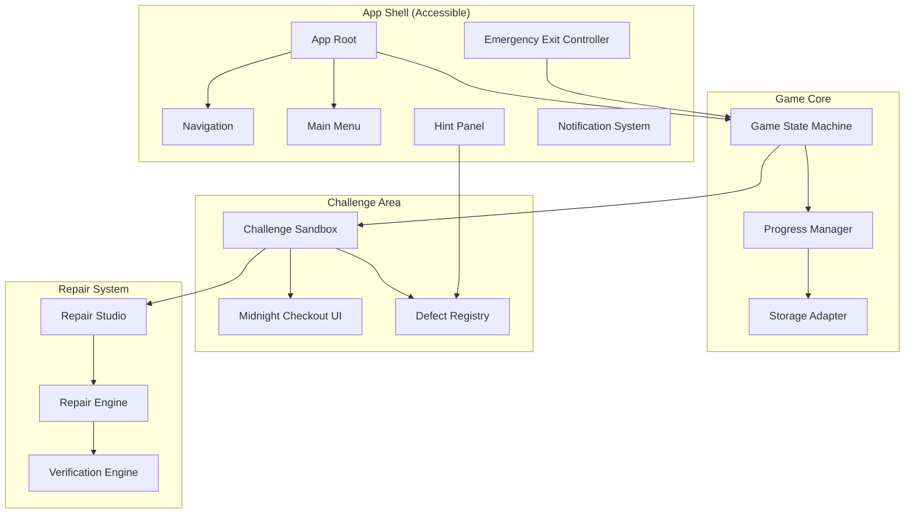
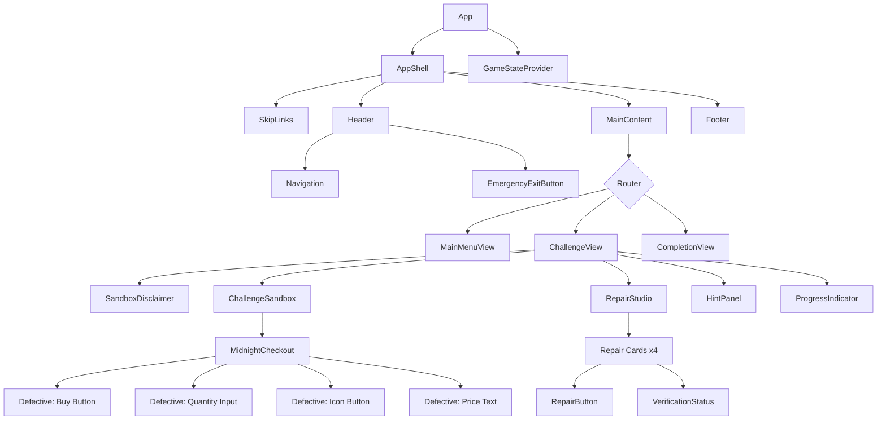
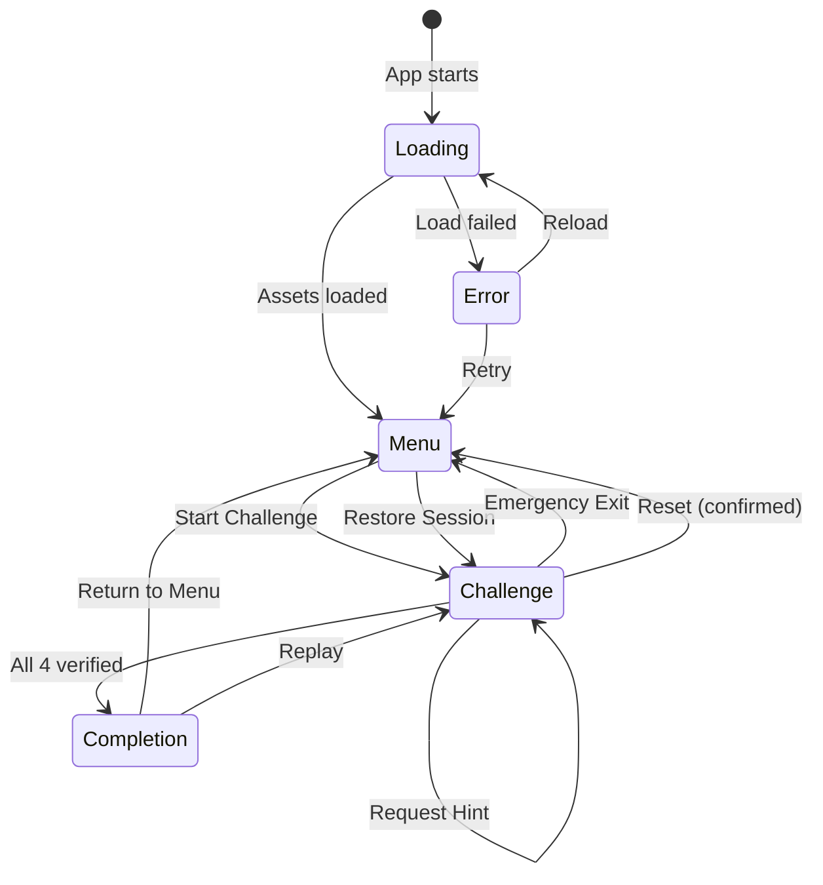
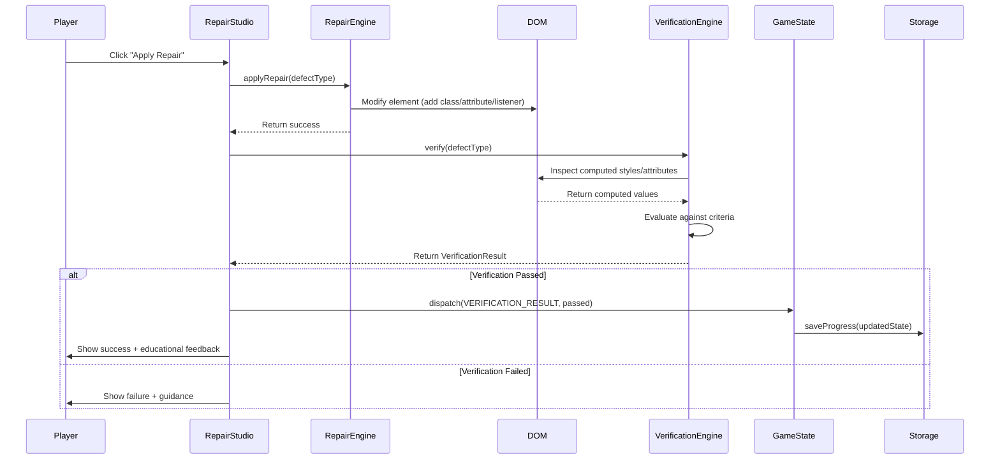
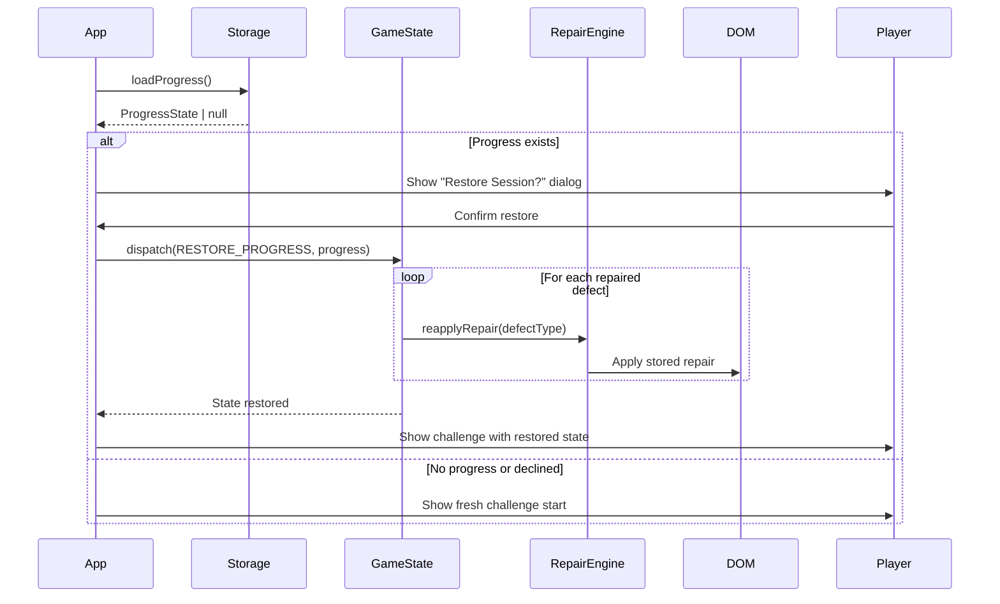
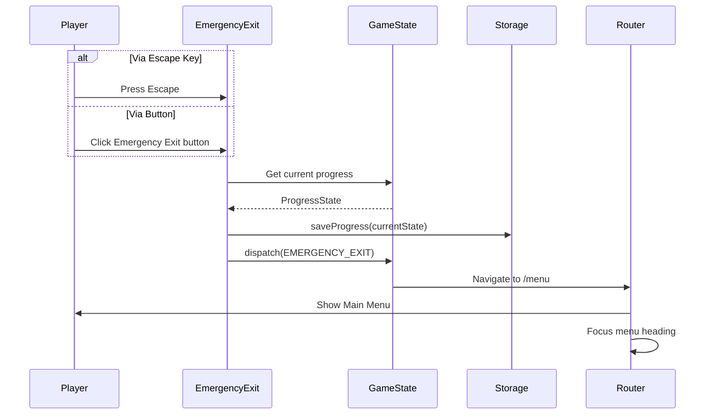

# Design Document: KeyQuest - The Haunted Accessibility Lab

## Overview

KeyQuest: The Haunted Accessibility Lab is a browser-based educational game that teaches web accessibility through interactive gameplay. Players navigate an intentionally inaccessible "Midnight Checkout" interface, discover four specific accessibility defects, apply code-backed repairs, and verify real improvements through DOM inspection.

### Design Philosophy

The architecture follows three core principles:

1. **Real Verification Over Simulation**: All repairs modify actual DOM/styles, and all verification checks inspect real computed values—no fake passing checks.
2. **Accessible Shell, Isolated Sandbox**: The app shell meets WCAG 2.1 AA while the challenge sandbox contains clearly-labeled intentional defects.
3. **Minimal Modular Architecture**: Components have single responsibilities with clear boundaries to avoid over-engineering.

### Technology Stack

- **React 18** with TypeScript for type-safe component development
- **Vite** for fast builds and static deployment
- **localStorage** for client-side persistence (no backend)
- **CSS Modules** for scoped styling
- **axe-core** for automated accessibility testing in development
- **Playwright** for independent browser test automation

---

## Architecture

The application follows a layered architecture with clear separation between the accessible app shell and the intentionally-broken challenge sandbox.

### High-Level Architecture Diagram



### Component Boundaries

| Layer | Responsibility | Accessibility |
|-------|---------------|---------------|
| App Shell | Navigation, menus, notifications, emergency exit | WCAG 2.1 AA compliant |
| Game Core | State management, progress tracking, persistence | N/A (logic only) |
| Challenge Sandbox | Contains defects, provides repair interface | Intentionally broken (labeled) |
| Repair System | Applies fixes, verifies DOM changes | Operates on sandbox DOM |

---

## Components and Interfaces

### Component Hierarchy



### Core Component Specifications

#### 1. GameStateProvider

Context provider managing global game state via React Context + useReducer.

```typescript
// State transitions
type GameState = 
  | { phase: 'loading' }
  | { phase: 'menu' }
  | { phase: 'challenge'; sandbox: SandboxState }
  | { phase: 'completion'; summary: CompletionSummary }
  | { phase: 'error'; error: ErrorInfo };
```

#### 2. ChallengeSandbox

Isolated container with visual boundary and ARIA labeling.

- Renders with `role="region"` and `aria-label="Challenge sandbox with intentional accessibility defects"`
- Visual border with warning styling
- Contains the Midnight Checkout component with all four defects

#### 3. RepairStudio

Interface for discovering defects and applying repairs.

- Lists all four defect types
- Shows discovery status, repair status, verification status for each
- Provides "Apply Repair" buttons that trigger RepairEngine
- Shows educational feedback after each repair

#### 4. VerificationEngine

Performs real DOM inspection to verify repairs.

```typescript
interface VerificationEngine {
  verifyFocusIndicator(element: HTMLElement): VerificationResult;
  verifyKeyboardActivation(element: HTMLElement): Promise<VerificationResult>;
  verifyAccessibleName(element: HTMLElement): VerificationResult;
  verifyContrastRatio(element: HTMLElement): VerificationResult;
}
```

#### 5. EmergencyExitController

Always-available escape mechanism.

- Renders fixed-position button with `data-testid="emergency-exit"`
- Listens for Escape key globally
- Bypasses all game state to return to menu
- Preserves progress before exiting

---

## Data Models

### TypeScript Interfaces

```typescript
// ============================================
// DEFECT TYPES
// ============================================

type DefectType = 
  | 'invisible-focus'
  | 'mouse-only-activation'
  | 'missing-accessible-name'
  | 'insufficient-contrast';

interface DefectDefinition {
  type: DefectType;
  elementSelector: string;
  description: string;
  educationalContext: string;
  wcagCriteria: string[];
}

interface DefectState {
  type: DefectType;
  discovered: boolean;
  discoveredAt: number | null;
  repaired: boolean;
  repairedAt: number | null;
  verified: boolean;
  verifiedAt: number | null;
  hintLevel: 0 | 1 | 2 | 3;
}

// ============================================
// REPAIR DEFINITIONS
// ============================================

interface RepairDefinition {
  defectType: DefectType;
  repairId: string;
  displayName: string;
  domChanges: DOMChange[];
  educationalFeedback: string;
}

type DOMChange = 
  | { type: 'add-style'; property: string; value: string }
  | { type: 'add-attribute'; name: string; value: string }
  | { type: 'add-event-listener'; event: string; handler: string }
  | { type: 'add-class'; className: string };

// ============================================
// VERIFICATION
// ============================================

interface VerificationResult {
  passed: boolean;
  defectType: DefectType;
  checkedAt: number;
  details: VerificationDetails;
}

type VerificationDetails =
  | FocusVerificationDetails
  | KeyboardVerificationDetails
  | AccessibleNameVerificationDetails
  | ContrastVerificationDetails;

interface FocusVerificationDetails {
  type: 'focus';
  outlineStyle: string;
  outlineWidth: string;
  outlineColor: string;
  boxShadow: string;
  hasVisibleIndicator: boolean;
  contrastRatio: number | null;
}

interface KeyboardVerificationDetails {
  type: 'keyboard';
  enterKeyWorks: boolean;
  spaceKeyWorks: boolean;
  eventFired: boolean;
}

interface AccessibleNameVerificationDetails {
  type: 'accessible-name';
  computedName: string;
  nameSource: 'aria-label' | 'aria-labelledby' | 'visible-text' | 'title' | 'none';
  isEmpty: boolean;
}

interface ContrastVerificationDetails {
  type: 'contrast';
  foregroundColor: string;
  backgroundColor: string;
  contrastRatio: number;
  requiredRatio: number;
  isLargeText: boolean;
  meetsRequirement: boolean;
}

// ============================================
// PROGRESS STATE (localStorage)
// ============================================

interface ProgressState {
  version: 1;
  sessionId: string;
  startedAt: number;
  lastUpdatedAt: number;
  defects: Record<DefectType, DefectState>;
  hintsUsed: Record<DefectType, number>;
  isComplete: boolean;
  completedAt: number | null;
}

// localStorage key: 'keyquest-progress-v1'
// Schema versioning allows future migrations

// ============================================
// GAME STATE
// ============================================

interface GameContext {
  state: GameState;
  dispatch: React.Dispatch<GameAction>;
  progress: ProgressState;
  saveProgress: () => void;
  resetProgress: () => void;
}

type GameAction =
  | { type: 'START_LOADING' }
  | { type: 'LOADING_COMPLETE' }
  | { type: 'LOADING_ERROR'; error: ErrorInfo }
  | { type: 'START_CHALLENGE' }
  | { type: 'DISCOVER_DEFECT'; defectType: DefectType }
  | { type: 'APPLY_REPAIR'; defectType: DefectType }
  | { type: 'VERIFICATION_RESULT'; result: VerificationResult }
  | { type: 'REQUEST_HINT'; defectType: DefectType }
  | { type: 'EMERGENCY_EXIT' }
  | { type: 'COMPLETE_LEVEL' }
  | { type: 'RESET_CHALLENGE' }
  | { type: 'RESTORE_PROGRESS'; progress: ProgressState };

// ============================================
// HINTS
// ============================================

interface HintDefinition {
  defectType: DefectType;
  level: 1 | 2 | 3;
  text: string;
}

// Level 1: General guidance ("Try navigating with Tab key")
// Level 2: Specific direction ("Focus the Buy button using keyboard")
// Level 3: Direct answer ("The Buy button has no visible focus indicator")

// ============================================
// ERROR HANDLING
// ============================================

interface ErrorInfo {
  code: string;
  message: string;
  userMessage: string;
  recoverable: boolean;
  timestamp: number;
}

// ============================================
// COMPLETION
// ============================================

interface CompletionSummary {
  totalTime: number;
  defectsRepaired: DefectType[];
  hintsUsed: Record<DefectType, number>;
  conceptsLearned: string[];
}
```

### State Diagram



---

## Repair Mechanisms: DOM/Style Changes

Each repair applies specific, verifiable changes to the DOM or computed styles.

### Repair 1: Invisible Focus

**Defect**: The "Buy Now" button has `outline: none` and no alternative focus indicator.

**Repair Implementation**:
```typescript
function repairInvisibleFocus(element: HTMLElement): void {
  // Add focus-visible styles via inline style or class
  element.classList.add('keyquest-focus-repaired');
  
  // The class applies:
  // .keyquest-focus-repaired:focus-visible {
  //   outline: 3px solid #005fcc;
  //   outline-offset: 2px;
  // }
}
```

**DOM Changes**:
- Adds class `keyquest-focus-repaired` to element
- CSS class provides `:focus-visible` styles with 3px solid outline
- Outline color `#005fcc` ensures 3:1 contrast against white/light backgrounds

**Educational Feedback**:
> "Repair applied: Added a visible focus indicator using the `:focus-visible` pseudo-class. The 3px blue outline has a contrast ratio of at least 3:1 against adjacent colors, meeting WCAG 2.4.7 (Focus Visible)."

### Repair 2: Mouse-Only Activation

**Defect**: The "Add to Cart" button uses `onClick` but lacks keyboard event handling, and is a `<div>` without proper role.

**Repair Implementation**:
```typescript
function repairMouseOnlyActivation(element: HTMLElement): void {
  // Add keyboard event listeners
  element.addEventListener('keydown', (e: KeyboardEvent) => {
    if (e.key === 'Enter' || e.key === ' ') {
      e.preventDefault();
      element.click(); // Trigger the same action as mouse click
    }
  });
  
  // Ensure element is focusable
  if (!element.hasAttribute('tabindex')) {
    element.setAttribute('tabindex', '0');
  }
  
  // Add button role if not a native button
  if (element.tagName !== 'BUTTON') {
    element.setAttribute('role', 'button');
  }
}
```

**DOM Changes**:
- Adds `keydown` event listener for Enter and Space keys
- Sets `tabindex="0"` if missing
- Sets `role="button"` for non-button elements

**Educational Feedback**:
> "Repair applied: Added keyboard event handlers for Enter and Space keys, matching native button behavior. The element now has `tabindex='0'` for focusability and `role='button'` for assistive technologies. This meets WCAG 2.1.1 (Keyboard)."

### Repair 3: Missing Accessible Name

**Defect**: The cart icon button has no text content, no `aria-label`, and no associated label.

**Repair Implementation**:
```typescript
function repairMissingAccessibleName(element: HTMLElement): void {
  // Determine appropriate label based on element context
  const contextualLabel = determineContextualLabel(element);
  
  // Apply aria-label
  element.setAttribute('aria-label', contextualLabel);
}

function determineContextualLabel(element: HTMLElement): string {
  // For the cart icon button in Midnight Checkout
  if (element.dataset.defectId === 'cart-icon') {
    return 'View shopping cart';
  }
  return 'Interactive element';
}
```

**DOM Changes**:
- Adds `aria-label` attribute with descriptive text
- For cart icon: `aria-label="View shopping cart"`

**Educational Feedback**:
> "Repair applied: Added `aria-label='View shopping cart'` to provide a programmatic name. Screen readers will now announce this label, meeting WCAG 4.1.2 (Name, Role, Value). Alternative approaches include `aria-labelledby` or visible text."

### Repair 4: Insufficient Contrast

**Defect**: The price text displays with low contrast (e.g., `#999` on `#fff` = 2.85:1 ratio).

**Repair Implementation**:
```typescript
function repairInsufficientContrast(element: HTMLElement): void {
  // Get current computed styles
  const computed = window.getComputedStyle(element);
  const currentColor = computed.color;
  
  // Apply high-contrast color
  element.style.color = '#595959'; // 7:1 contrast against white
  
  // Store original for potential undo
  element.dataset.originalColor = currentColor;
}
```

**DOM Changes**:
- Sets inline `color` style to `#595959`
- Achieves 7:1 contrast ratio against `#ffffff` background
- Stores original color in `data-original-color` attribute

**Educational Feedback**:
> "Repair applied: Changed text color from `#999999` (2.85:1 ratio) to `#595959` (7:1 ratio). WCAG 1.4.3 requires at least 4.5:1 for normal text. The new color exceeds this requirement for better readability."

---

## Correctness Properties

*A property is a characteristic or behavior that should hold true across all valid executions of a system—essentially, a formal statement about what the system should do. Properties serve as the bridge between human-readable specifications and machine-verifiable correctness guarantees.*

### Property 1: Repair Persistence Across Re-renders

*For any* applied repair and any subsequent React re-render caused by state changes, the DOM modifications from that repair SHALL remain present until an explicit reset action is invoked.

**Validates: Requirements 4.3, 5.3, 6.3, 7.3**

### Property 2: Verification Reflects Actual DOM State

*For any* verification result, the result SHALL accurately reflect the current DOM state—a passing verification for focus indicators implies `getComputedStyle()` returns non-transparent outline or box-shadow values when the element has focus.

**Validates: Requirements 8.1, 8.2, 8.3, 8.4, 8.5**

### Property 3: Progress State Round-Trip Consistency

*For any* progress state saved to localStorage and subsequently restored, re-applying the repairs recorded in that state SHALL produce a DOM state equivalent to the state when progress was saved.

**Validates: Requirements 12.1, 12.2, 12.3, 12.5**

### Property 4: Emergency Exit Reachability

*For any* focusable element within the Challenge Sandbox, the Emergency Exit button SHALL be reachable via Tab key navigation within 5 key presses (Tab or Shift+Tab).

**Validates: Requirements 13.1, 13.2, 13.3**

### Property 5: Defect Count Invariant

*For any* state of the Challenge Sandbox after initialization, the sum of (unrepaired defects + repaired defects) SHALL equal exactly four.

**Validates: Requirements 2.3**

### Property 6: Hint Progression

*For any* defect type and any sequence of hint requests, the hint level SHALL increase monotonically from 0 to 3, and subsequent requests at level 3 SHALL continue returning level 3 hints.

**Validates: Requirements 10.3, 10.4**

### Property 7: Keyboard Activation Equivalence

*For any* element repaired with the Mouse-Only Activation fix, activation via Enter key, Space key, or mouse click SHALL trigger identical behavior (same event handler, same state changes).

**Validates: Requirements 5.1, 5.2**

### Property 8: Focus Indicator Visibility Verification

*For any* element repaired with the Invisible Focus fix, when the element receives focus via keyboard navigation, `getComputedStyle()` SHALL return outline or box-shadow values that differ from the unfocused state.

**Validates: Requirements 4.1, 4.2, 8.2**

### Property 9: Accessible Name Non-Empty

*For any* element repaired with the Missing Accessible Name fix, the computed accessible name (via `element.ariaLabel` or accessibility tree inspection) SHALL be a non-empty string.

**Validates: Requirements 6.1, 6.2, 8.4**

### Property 10: Contrast Ratio Threshold

*For any* element repaired with the Insufficient Contrast fix, the computed contrast ratio between foreground color and background color SHALL be at least 4.5:1 for normal text or 3:1 for large text (18pt+ or 14pt+ bold).

**Validates: Requirements 7.1, 7.2, 8.5**

---

## Error Handling

### Error Categories and Strategies

| Category | Examples | Strategy | User Experience |
|----------|----------|----------|-----------------|
| Asset Loading | Network failure, missing file | Retry with exponential backoff | Loading screen with retry button |
| localStorage | Storage quota exceeded, disabled | Graceful degradation | Warning banner, continue without persistence |
| DOM Mutation | Element not found, wrong state | Sandbox reset offer | Error modal with reset option |
| Verification | Unexpected DOM state | Detailed failure message | Repair feedback with guidance |
| JavaScript Runtime | Uncaught exceptions | Error boundary | Error screen preserving progress |

### Error Boundary Implementation

```typescript
interface ErrorBoundaryState {
  hasError: boolean;
  error: ErrorInfo | null;
  progressSnapshot: ProgressState | null;
}

// ErrorBoundary wraps ChallengeSandbox and RepairStudio
// On error:
// 1. Captures current progress state
// 2. Logs error details
// 3. Displays recovery UI with options:
//    - "Retry" - attempts to re-render
//    - "Reset Sandbox" - clears sandbox state, keeps progress
//    - "Return to Menu" - preserves progress, exits challenge
```

### localStorage Unavailability

```typescript
function checkStorageAvailability(): boolean {
  try {
    const test = '__storage_test__';
    localStorage.setItem(test, test);
    localStorage.removeItem(test);
    return true;
  } catch {
    return false;
  }
}

// If unavailable:
// - Set storageAvailable: false in context
// - Show persistent banner: "Progress cannot be saved in this browser"
// - All functionality works, just without persistence
```

### Verification Failure Handling

When verification fails, provide actionable feedback:

```typescript
interface VerificationFailure {
  defectType: DefectType;
  expectedState: string;
  actualState: string;
  suggestion: string;
}

// Example failure message:
// "Focus indicator verification failed. Expected outline to be visible,
//  but computed outline-style is 'none'. The repair may not have been
//  applied correctly. Try resetting the sandbox and reapplying the repair."
```

---

## Testing Strategy

### Testing Pyramid

```
                    /\
                   /  \  E2E (Playwright)
                  /----\  - Full game flows
                 /      \  - Cross-browser
                /--------\
               / Integration \  - Component integration
              /   (Vitest)    \  - State management
             /------------------\
            /     Unit Tests     \  - Verification logic
           /       (Vitest)       \  - Repair functions
          /------------------------\  - Pure utilities
```

### 1. In-App Verification (Game Internal)

The game performs real-time verification as part of gameplay:

```typescript
// VerificationEngine methods called during gameplay
class VerificationEngine {
  verifyFocusIndicator(element: HTMLElement): VerificationResult {
    // Focus the element programmatically
    element.focus();
    const computed = getComputedStyle(element);
    
    const outlineStyle = computed.outlineStyle;
    const outlineWidth = computed.outlineWidth;
    const boxShadow = computed.boxShadow;
    
    const hasVisibleOutline = outlineStyle !== 'none' && 
                              parseFloat(outlineWidth) > 0;
    const hasBoxShadow = boxShadow !== 'none';
    
    return {
      passed: hasVisibleOutline || hasBoxShadow,
      defectType: 'invisible-focus',
      checkedAt: Date.now(),
      details: {
        type: 'focus',
        outlineStyle,
        outlineWidth,
        outlineColor: computed.outlineColor,
        boxShadow,
        hasVisibleIndicator: hasVisibleOutline || hasBoxShadow,
        contrastRatio: null // Would require color parsing
      }
    };
  }
  
  async verifyKeyboardActivation(element: HTMLElement): Promise<VerificationResult> {
    let activated = false;
    const handler = () => { activated = true; };
    
    element.addEventListener('click', handler, { once: true });
    element.focus();
    
    // Dispatch synthetic keyboard event
    const enterEvent = new KeyboardEvent('keydown', {
      key: 'Enter',
      bubbles: true
    });
    element.dispatchEvent(enterEvent);
    
    // Small delay to allow event propagation
    await new Promise(resolve => setTimeout(resolve, 50));
    
    element.removeEventListener('click', handler);
    
    return {
      passed: activated,
      defectType: 'mouse-only-activation',
      checkedAt: Date.now(),
      details: {
        type: 'keyboard',
        enterKeyWorks: activated,
        spaceKeyWorks: false, // Would need separate test
        eventFired: activated
      }
    };
  }
  
  verifyAccessibleName(element: HTMLElement): VerificationResult {
    // Check multiple sources for accessible name
    const ariaLabel = element.getAttribute('aria-label');
    const ariaLabelledBy = element.getAttribute('aria-labelledby');
    const title = element.getAttribute('title');
    const textContent = element.textContent?.trim();
    
    let computedName = '';
    let nameSource: AccessibleNameVerificationDetails['nameSource'] = 'none';
    
    if (ariaLabel) {
      computedName = ariaLabel;
      nameSource = 'aria-label';
    } else if (ariaLabelledBy) {
      const labelElement = document.getElementById(ariaLabelledBy);
      computedName = labelElement?.textContent?.trim() || '';
      nameSource = 'aria-labelledby';
    } else if (textContent) {
      computedName = textContent;
      nameSource = 'visible-text';
    } else if (title) {
      computedName = title;
      nameSource = 'title';
    }
    
    return {
      passed: computedName.length > 0,
      defectType: 'missing-accessible-name',
      checkedAt: Date.now(),
      details: {
        type: 'accessible-name',
        computedName,
        nameSource,
        isEmpty: computedName.length === 0
      }
    };
  }
  
  verifyContrastRatio(element: HTMLElement): VerificationResult {
    const computed = getComputedStyle(element);
    const fgColor = computed.color;
    const bgColor = getBackgroundColor(element);
    
    const ratio = calculateContrastRatio(
      parseColor(fgColor),
      parseColor(bgColor)
    );
    
    const fontSize = parseFloat(computed.fontSize);
    const fontWeight = parseInt(computed.fontWeight, 10);
    const isLargeText = fontSize >= 24 || (fontSize >= 18.66 && fontWeight >= 700);
    const requiredRatio = isLargeText ? 3 : 4.5;
    
    return {
      passed: ratio >= requiredRatio,
      defectType: 'insufficient-contrast',
      checkedAt: Date.now(),
      details: {
        type: 'contrast',
        foregroundColor: fgColor,
        backgroundColor: bgColor,
        contrastRatio: ratio,
        requiredRatio,
        isLargeText,
        meetsRequirement: ratio >= requiredRatio
      }
    };
  }
}
```

### 2. Independent Playwright Tests (External Automation)

Playwright tests validate that the game's verification logic produces correct results:

```typescript
// tests/verification.spec.ts
import { test, expect } from '@playwright/test';

test.describe('Defect Verification Independence', () => {
  test('focus indicator repair produces verifiable DOM changes', async ({ page }) => {
    await page.goto('/');
    await page.click('[data-testid="start-challenge"]');
    
    // Get initial state
    const buyButton = page.locator('[data-testid="defect-invisible-focus"]');
    await buyButton.focus();
    
    const beforeOutline = await buyButton.evaluate(el => 
      getComputedStyle(el).outlineStyle
    );
    expect(beforeOutline).toBe('none');
    
    // Apply repair
    await page.click('[data-testid="repair-invisible-focus"]');
    
    // Verify DOM change independently
    await buyButton.focus();
    const afterOutline = await buyButton.evaluate(el => 
      getComputedStyle(el).outlineStyle
    );
    expect(afterOutline).not.toBe('none');
  });
  
  test('keyboard activation repair enables Enter key', async ({ page }) => {
    await page.goto('/');
    await page.click('[data-testid="start-challenge"]');
    
    const addButton = page.locator('[data-testid="defect-mouse-only"]');
    
    // Before repair: keyboard should not activate
    await addButton.focus();
    let clickFired = false;
    await page.exposeFunction('recordClick', () => { clickFired = true; });
    await addButton.evaluate(el => {
      el.addEventListener('click', () => (window as any).recordClick());
    });
    
    await page.keyboard.press('Enter');
    expect(clickFired).toBe(false);
    
    // Apply repair
    await page.click('[data-testid="repair-mouse-only"]');
    
    // After repair: keyboard should activate
    await addButton.focus();
    await page.keyboard.press('Enter');
    expect(clickFired).toBe(true);
  });
  
  test('accessible name repair adds aria-label', async ({ page }) => {
    await page.goto('/');
    await page.click('[data-testid="start-challenge"]');
    
    const iconButton = page.locator('[data-testid="defect-missing-name"]');
    
    const beforeLabel = await iconButton.getAttribute('aria-label');
    expect(beforeLabel).toBeNull();
    
    await page.click('[data-testid="repair-missing-name"]');
    
    const afterLabel = await iconButton.getAttribute('aria-label');
    expect(afterLabel).toBeTruthy();
    expect(afterLabel!.length).toBeGreaterThan(0);
  });
  
  test('contrast repair improves computed color ratio', async ({ page }) => {
    await page.goto('/');
    await page.click('[data-testid="start-challenge"]');
    
    const priceText = page.locator('[data-testid="defect-low-contrast"]');
    
    const beforeColor = await priceText.evaluate(el => 
      getComputedStyle(el).color
    );
    
    await page.click('[data-testid="repair-low-contrast"]');
    
    const afterColor = await priceText.evaluate(el => 
      getComputedStyle(el).color
    );
    
    expect(afterColor).not.toBe(beforeColor);
    // Could add actual contrast calculation here
  });
});
```

### 3. axe-core Integration (Automated Accessibility)

```typescript
// tests/accessibility.spec.ts
import { test, expect } from '@playwright/test';
import AxeBuilder from '@axe-core/playwright';

test.describe('App Shell Accessibility', () => {
  test('main menu meets WCAG 2.1 AA', async ({ page }) => {
    await page.goto('/');
    
    const results = await new AxeBuilder({ page })
      .exclude('[data-testid="challenge-sandbox"]') // Exclude intentional defects
      .analyze();
    
    expect(results.violations).toEqual([]);
  });
  
  test('app shell during challenge meets WCAG 2.1 AA', async ({ page }) => {
    await page.goto('/');
    await page.click('[data-testid="start-challenge"]');
    
    const results = await new AxeBuilder({ page })
      .exclude('[data-testid="challenge-sandbox"]')
      .analyze();
    
    expect(results.violations).toEqual([]);
  });
  
  test('challenge sandbox has expected defects before repair', async ({ page }) => {
    await page.goto('/');
    await page.click('[data-testid="start-challenge"]');
    
    // Run axe only on sandbox - should find violations
    const results = await new AxeBuilder({ page })
      .include('[data-testid="challenge-sandbox"]')
      .analyze();
    
    // Expect specific violation types
    const violationIds = results.violations.map(v => v.id);
    expect(violationIds).toContain('color-contrast');
    expect(violationIds).toContain('button-name');
  });
  
  test('challenge sandbox passes axe after all repairs', async ({ page }) => {
    await page.goto('/');
    await page.click('[data-testid="start-challenge"]');
    
    // Apply all repairs
    await page.click('[data-testid="repair-invisible-focus"]');
    await page.click('[data-testid="repair-mouse-only"]');
    await page.click('[data-testid="repair-missing-name"]');
    await page.click('[data-testid="repair-low-contrast"]');
    
    const results = await new AxeBuilder({ page })
      .include('[data-testid="challenge-sandbox"]')
      .analyze();
    
    expect(results.violations).toEqual([]);
  });
});
```

### Testing Requirements Summary

| Test Type | Purpose | Runner | Coverage |
|-----------|---------|--------|----------|
| Unit Tests | Verification logic, contrast calculation, color parsing | Vitest | Pure functions |
| Component Tests | React component rendering, state transitions | Vitest + React Testing Library | Components |
| Integration Tests | State management, persistence, repair+verify flow | Vitest | Game core |
| E2E Tests | Full gameplay flows, keyboard navigation | Playwright | User journeys |
| Accessibility Tests | WCAG compliance, defect detection | Playwright + axe-core | Accessibility |

### Verification Reliability Notes

**Reliably Verifiable**:
- Focus indicator presence (getComputedStyle for outline/box-shadow)
- Accessible name presence (aria-label, aria-labelledby, textContent)
- Color contrast ratio (computed color values with known algorithm)
- Keyboard event handling (synthetic event dispatch)

**Difficult to Verify Programmatically**:
- Focus indicator contrast ratio against adjacent colors (requires knowing all adjacent colors, which may vary)
- Exact visual appearance of focus indicator (browser rendering differences)

**Proposed Narrower Alternative for Focus Contrast**:
Instead of verifying 3:1 contrast ratio programmatically (which requires complex color detection of adjacent pixels), the repair uses a known-safe color (`#005fcc`) that achieves 3:1 against both white and common light backgrounds. The verification confirms the outline color matches the expected value.

---

## Keyboard Focus Management

### Principles

1. **No Focus Trapping**: Users can always Tab out of any component
2. **Logical Focus Order**: Focus moves left-to-right, top-to-bottom following visual layout
3. **Focus Restoration**: When modals close, focus returns to trigger element
4. **Skip Links**: Bypass navigation to reach main content quickly

### Focus Management Patterns

```typescript
// Focus restoration hook
function useFocusRestore() {
  const triggerRef = useRef<HTMLElement | null>(null);
  
  const saveTrigger = useCallback((element: HTMLElement) => {
    triggerRef.current = element;
  }, []);
  
  const restoreFocus = useCallback(() => {
    triggerRef.current?.focus();
  }, []);
  
  return { saveTrigger, restoreFocus };
}

// Modal focus management (NOT trapping, just initial focus)
function useModalFocus(isOpen: boolean) {
  const modalRef = useRef<HTMLDivElement>(null);
  const previousFocus = useRef<HTMLElement | null>(null);
  
  useEffect(() => {
    if (isOpen) {
      previousFocus.current = document.activeElement as HTMLElement;
      // Focus first focusable element in modal
      const firstFocusable = modalRef.current?.querySelector<HTMLElement>(
        'button, [href], input, select, textarea, [tabindex]:not([tabindex="-1"])'
      );
      firstFocusable?.focus();
    } else {
      previousFocus.current?.focus();
    }
  }, [isOpen]);
  
  return modalRef;
}
```

### Emergency Exit Focus Behavior

- Emergency Exit button is always in the tab order
- Positioned early in DOM order (in header, after skip links)
- Escape key listener is global, does not require focus on specific element
- After emergency exit, focus moves to main menu heading

### Challenge Sandbox Focus Order

```
Skip Links → Emergency Exit → Hint Button → Sandbox Disclaimer →
  [Sandbox Content: Defective elements in checkout order] →
  Repair Studio Cards → Progress Indicator
```

---

## Reduced Motion Support

### Implementation

```typescript
// Hook for checking motion preference
function usePrefersReducedMotion(): boolean {
  const [prefersReducedMotion, setPrefersReducedMotion] = useState(
    () => window.matchMedia('(prefers-reduced-motion: reduce)').matches
  );
  
  useEffect(() => {
    const mediaQuery = window.matchMedia('(prefers-reduced-motion: reduce)');
    const handler = (e: MediaQueryListEvent) => setPrefersReducedMotion(e.matches);
    mediaQuery.addEventListener('change', handler);
    return () => mediaQuery.removeEventListener('change', handler);
  }, []);
  
  return prefersReducedMotion;
}

// Motion context for manual override
interface MotionSettings {
  reducedMotion: boolean;
  setReducedMotion: (value: boolean) => void;
  source: 'system' | 'user';
}

const MotionContext = createContext<MotionSettings | null>(null);
```

### CSS Implementation

```css
/* Base animations */
.notification-enter {
  animation: slideIn 300ms ease-out;
}

/* Reduced motion override */
@media (prefers-reduced-motion: reduce) {
  .notification-enter {
    animation: none;
    opacity: 1;
  }
  
  * {
    transition-duration: 0.01ms !important;
    animation-duration: 0.01ms !important;
  }
}

/* Manual override via data attribute */
[data-reduced-motion="true"] .notification-enter {
  animation: none;
  opacity: 1;
}
```

### Critical Information Independence

No game state or critical information is conveyed through animation alone:
- Defect discovery: notification + state change (both visible without animation)
- Repair success: status badge + text update
- Level completion: full-screen summary (content-based, not animation-based)
- Errors: static error message display

---

## Persistence Mechanism

### localStorage Schema

```typescript
// Key: 'keyquest-progress-v1'
// Value: JSON-serialized ProgressState

interface ProgressState {
  version: 1;  // For future migrations
  sessionId: string;  // UUID for analytics/debugging
  startedAt: number;  // Unix timestamp
  lastUpdatedAt: number;
  defects: {
    'invisible-focus': DefectState;
    'mouse-only-activation': DefectState;
    'missing-accessible-name': DefectState;
    'insufficient-contrast': DefectState;
  };
  hintsUsed: {
    'invisible-focus': number;
    'mouse-only-activation': number;
    'missing-accessible-name': number;
    'insufficient-contrast': number;
  };
  isComplete: boolean;
  completedAt: number | null;
}

// Key: 'keyquest-settings-v1'
// Value: JSON-serialized UserSettings

interface UserSettings {
  version: 1;
  reducedMotion: boolean | null;  // null = use system preference
  audioMuted: boolean;
}
```

### Storage Operations

```typescript
const PROGRESS_KEY = 'keyquest-progress-v1';
const SETTINGS_KEY = 'keyquest-settings-v1';

class StorageAdapter {
  private available: boolean;
  
  constructor() {
    this.available = this.checkAvailability();
  }
  
  private checkAvailability(): boolean {
    try {
      const test = '__storage_test__';
      localStorage.setItem(test, test);
      localStorage.removeItem(test);
      return true;
    } catch {
      return false;
    }
  }
  
  isAvailable(): boolean {
    return this.available;
  }
  
  saveProgress(state: ProgressState): boolean {
    if (!this.available) return false;
    try {
      localStorage.setItem(PROGRESS_KEY, JSON.stringify(state));
      return true;
    } catch (e) {
      // Quota exceeded or other error
      console.error('Failed to save progress:', e);
      return false;
    }
  }
  
  loadProgress(): ProgressState | null {
    if (!this.available) return null;
    try {
      const data = localStorage.getItem(PROGRESS_KEY);
      if (!data) return null;
      
      const parsed = JSON.parse(data);
      // Version check for future migrations
      if (parsed.version !== 1) {
        return this.migrateProgress(parsed);
      }
      return parsed as ProgressState;
    } catch {
      return null;
    }
  }
  
  clearProgress(): void {
    if (!this.available) return;
    localStorage.removeItem(PROGRESS_KEY);
  }
  
  private migrateProgress(oldData: unknown): ProgressState | null {
    // Future: handle version migrations
    return null;
  }
}
```

### Debounced Auto-Save

```typescript
function useAutoSave(progress: ProgressState, storage: StorageAdapter) {
  const saveTimeoutRef = useRef<number>();
  
  useEffect(() => {
    // Debounce saves to avoid excessive writes
    if (saveTimeoutRef.current) {
      clearTimeout(saveTimeoutRef.current);
    }
    
    saveTimeoutRef.current = window.setTimeout(() => {
      storage.saveProgress({
        ...progress,
        lastUpdatedAt: Date.now()
      });
    }, 500);  // 500ms debounce, well within 1s requirement
    
    return () => {
      if (saveTimeoutRef.current) {
        clearTimeout(saveTimeoutRef.current);
      }
    };
  }, [progress, storage]);
}
```

---

## Sequence Diagrams

### Repair Flow



### Progress Restoration Flow



### Emergency Exit Flow



---

## Test Data Attributes

All key elements expose `data-testid` attributes for test automation:

| Element | data-testid | Purpose |
|---------|-------------|---------|
| Start Challenge button | `start-challenge` | Menu entry point |
| Challenge Sandbox container | `challenge-sandbox` | axe-core include/exclude |
| Emergency Exit button | `emergency-exit` | E2E navigation |
| Defect: Focus | `defect-invisible-focus` | Verification target |
| Defect: Keyboard | `defect-mouse-only` | Verification target |
| Defect: Name | `defect-missing-name` | Verification target |
| Defect: Contrast | `defect-low-contrast` | Verification target |
| Repair button: Focus | `repair-invisible-focus` | E2E repair action |
| Repair button: Keyboard | `repair-mouse-only` | E2E repair action |
| Repair button: Name | `repair-missing-name` | E2E repair action |
| Repair button: Contrast | `repair-low-contrast` | E2E repair action |
| Hint button | `hint-button` | Hint flow testing |
| Reset button | `reset-button` | Reset flow testing |
| Reset confirm button | `reset-confirm` | Reset confirmation |
| Level complete screen | `level-complete` | Completion verification |

---

## Appendix: Verification Reliability Analysis

### Requirements That Cannot Be Reliably Verified

| Requirement | Issue | Proposed Alternative |
|-------------|-------|---------------------|
| 4.2: "3:1 contrast against adjacent colors" | Adjacent colors vary; requires pixel-level analysis | Verify outline color matches known-safe value (`#005fcc`) |
| 14.1: "WCAG 2.1 AA compliance" | Full compliance requires manual testing | Use axe-core for automated checks; document remaining manual checks |
| 15.1: "disable or minimize non-essential animations" | "Non-essential" is subjective | Verify CSS media query is applied; list animations as essential/non-essential |

### Verification Confidence Levels

| Verification | Confidence | Method |
|--------------|------------|--------|
| Focus indicator present | High | getComputedStyle outline/box-shadow |
| Keyboard activation works | High | Synthetic event dispatch |
| Accessible name non-empty | High | Direct attribute/property read |
| Contrast ratio meets threshold | Medium | Color parsing + calculation (edge cases with gradients/images) |
| Focus indicator contrast | Low | Would require adjacent color detection |
