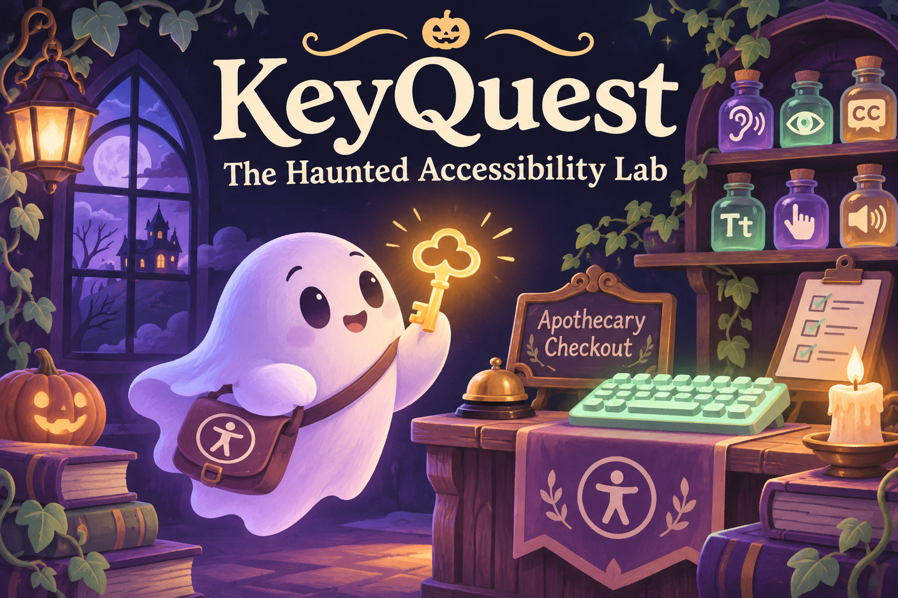

# KeyQuest
### The Haunted Accessibility Lab

**Lift the curse. Learn the barrier. Repair the real interface.**

An interactive browser game about repairing accessibility barriers in a haunted apothecary. Light the counter lantern in Midnight Checkout, then brew a potion in Potion Pantry. Built for **Kiroween 2026 · Costume Contest**.


[](LICENSE)



*AI-generated cover artwork.*

> **Accessibility notice:** The rooms contain five intentional accessibility barriers inside their labeled sandboxes. The surrounding application is designed to remain usable while you explore them. You can discover defects directly in the Repair Studio. Automated checks do not establish full WCAG conformance or certification.

## Overview

In **Midnight Checkout**, the player restores a focus ring, keyboard activation, a button name, and readable contrast to complete a shopper's order. In **Potion Pantry**, the player adds labels to jars identified by color alone, then uses the repaired shelf to follow a recipe. Repairs change the live interface, and optional explanations show the code and verification evidence.

See the [original Midnight Checkout](release/screenshots/midnight-checkout.png) and [main menu](release/screenshots/main-menu.png) in screenshots from the November 15, 2026 release checkpoint.

## Features

- Two playable rooms linked by a door selector. Clocktower Gate is marked **Coming later**.
- Repair Studio with code comparisons, educational feedback, and live verification.
- Three progressive hints per defect.
- Completion summary with elapsed time, hints used, and concepts encountered.
- Browser-local progress with migration from older Checkout saves, per-room resets, and a confirmed **Start over**.
- Emergency Exit and an `Escape` shortcut during the challenge; open modals handle `Escape` first.
- Challenge render-error recovery and game-module loading/retry UI.
- Responsive haunted styling and reduced-motion support.
- Unit tests, browser tests, and automated accessibility scans.

## Gameplay

**Discover → Repair → Verify → Use**

1. Enter Midnight Checkout and inspect the checkout button beside the lantern.
2. Apply and verify a repair, then use the repaired control to light the lantern. Open **How this repair works** for code and verification evidence.
3. Lift the remaining curses, place the order, and take the Pantry Key.
4. Enter Potion Pantry, restore the jar labels, and follow the recipe. You can remove a wrong ingredient and keep brewing.
5. Bottle the lantern potion and return to the doors.

Use hints when needed or leave through Emergency Exit. Resume from the opening screen to pick up your browser-local progress.

## Accessibility challenges

| Challenge | Actual repair | Verification | Related WCAG criterion |
| --- | --- | --- | --- |
| Invisible Focus | Adds a focus-repair class with a visible outline | Inspects computed outline and box-shadow while focused | 2.4.7 Focus Visible |
| Mouse-Only Activation | Adds Enter/Space handling and a button role to the custom control | Dispatches keyboard events and observes click activation | 2.1.1 Keyboard |
| Missing Accessible Name | Adds `aria-label="View shopping cart"` | Inspects naming attributes and text | 4.1.2 Name, Role, Value |
| Insufficient Text Contrast | Changes the price text to a light foreground | Calculates contrast from computed colors and text size | 1.4.3 Contrast (Minimum) |
| Color-Only Ingredient Jars | Shows a symbol and a visible name on each jar button | Checks the visible labels and button names | 1.4.1 Use of Color, 4.1.2 Name, Role, Value, 2.5.3 Label in Name |

The name check is a focused DOM heuristic, not the complete accessible-name algorithm. Focus verification detects visible styles but does not prove unclipped rendering or adequate contrast in every context. These checks teach specific repairs; they are not a general-purpose audit.

## Architecture

**React 19 · TypeScript · Vite · CSS Modules**

```text
App → GameProvider + AppShell
  └─ ApplicationLoader → dynamically imported GameRouter
       ├─ MainMenuView
       ├─ DoorSelectorView
       ├─ ChallengeView → MidnightCheckout + RepairStudio
       ├─ PantryView → PotionPantry + RepairStudio
       └─ CompletionView
```

- **State:** React Context and a reducer track discoveries, repairs, hints, and room actions. The room registry derives door availability from progress.
- **Persistence:** `StorageAdapter` loads progress from `localStorage`. The progress schema validates and migrates older saves. Saved repairs are reapplied when a room mounts.
- **Repair:** `RepairEngine` changes live attributes, keyboard listeners, and CSS.
- **Verification:** `VerificationEngine` returns evidence from live behavior and computed styles. Players use the verified repairs to complete each room's objective.
- **Recovery:** The error boundary remounts sandbox and studio together. Loading recovery covers dynamically loaded game JS/CSS, not document/bootstrap failures before React starts.
- **Delivery:** A static client application with no server API, database, or authentication service.

Explore the [source](src), [tests](tests), [Midnight Checkout spec](.kiro/specs/adventure-phase-1-midnight-checkout/requirements.md), and [Potion Pantry spec](.kiro/specs/adventure-phase-2-potion-pantry/requirements.md).

## Getting started

Use **Node.js 26** and npm. Install from the repository root using the committed lockfile. No API keys or environment variables are required.

```bash
npm ci
npm run dev
```

Open the URL printed by Vite, normally `http://localhost:5173`. If that port is occupied, Vite may choose another; browser tests expect port 5173.

### Quality checks

```bash
npm run lint
npm run typecheck
npm run test:unit
npx playwright install chromium
npm run test:e2e -- --project=chromium --workers=1
```

On Linux, use `npx playwright install --with-deps chromium` to install browser system dependencies.

The default Playwright project is Chromium. To opt into Firefox/WebKit, first run `npx playwright install chromium firefox webkit`, then:

```powershell
# PowerShell
$env:KEYQUEST_ALL_BROWSERS='1'
npm run test:e2e -- --workers=1
Remove-Item Env:KEYQUEST_ALL_BROWSERS
```

```bash
# POSIX shells
KEYQUEST_ALL_BROWSERS=1 npm run test:e2e -- --workers=1
```

Add `--grep '@axe'` to select tagged accessibility scans. Generated reports and traces are local evidence, ignored by Git.

### Production build

```bash
npm run build
npm run preview -- --host 127.0.0.1 --port 4173
```

With preview running, use a second terminal:

```bash
node tests/production/startup-smoke.mjs
```

Static output goes to `dist/`. No hosted application or demo video is published as part of this checkpoint.

## Accessibility and verification

The sandbox boundary and disclaimer distinguish deliberately broken examples from the application shell. Shell scans exclude only the intended sandbox. Tests also confirm selected defects before repair and exercise navigation, focus, persistence, hints, reset, completion, startup, and actual error recovery.

At source baseline `5c0e8e4`, the publication review independently ran the build, ESLint, **60 unit tests**, and **78 Chromium E2E tests**, all passing. These are local results, not a claim that hosted CI has run. See the [v1.0 checkpoint](release/V1_0_CHECKPOINT.md) for provenance.

Known limitations:

- Manual NVDA/VoiceOver testing, comprehensive zoom/reflow checks, and focus-indicator clipping assessment remain pending.
- The prior engineering report records an unresolved Firefox axe crash and incomplete WebKit results. Neither engine has been independently rerun for this publication review.
- Parallel accessibility scans have shown instability; use one worker for controlled runs.

Zero axe violations does not mean every check was complete, nor replace testing with assistive technologies and people with disabilities.

## Built with Kiro

KeyQuest was developed with **Kiro IDE** through a specification-driven workflow. The developer identifies Claude Opus 4.5 as the primary Kiro model. The repository preserves the actual artifacts at [`.kiro/`](.kiro):

| Artifact | Role |
| --- | --- |
| [Requirements](.kiro/specs/keyquest-haunted-accessibility-lab/requirements.md) | User stories and acceptance criteria for learning, repairs, recovery, and accessibility boundaries |
| [Design](.kiro/specs/keyquest-haunted-accessibility-lab/design.md) | Architecture, state models, repair/verification contracts, and proposed validation |
| [Tasks](.kiro/specs/keyquest-haunted-accessibility-lab/tasks.md) | Implementation breakdown with requirement references; historical checkboxes are not a current test report |
| [Steering](.kiro/steering) | Product, accessibility, visual design, structure, technology, and quality guidance |
| [Hooks](.kiro/hooks) | Configured save-time lint/advisory accessibility review and post-task typecheck/unit-test commands |
| [Accessibility auditor](.kiro/agents/accessibility-auditor.md) | Read-only review instructions separating observed findings from unverified claims |
| [MCP configuration](.kiro/settings/mcp.json) | Playwright MCP server configuration |

Kiro supported requirements, design, core implementation, integration, and engineering review. Configuration alone does not prove that every hook, agent, or MCP operation ran. Original planning files retain historical assumptions, including an older React version and contrast example; current source and the lockfile describe shipped behavior.

Additional AI-assisted review, hardening, validation, and release preparation used ChatGPT/Codex. Kiro is not claimed as the exclusive author. No Kiro Crew/Powers usage or completed property-based testing campaign is asserted.

## Kiroween 2026

Intended category: **Costume Contest**. The haunted store provides a familiar task, the laboratory framing explains deliberate defects, and verified repairs advance the escape. Clear sandbox boundaries and reduced-motion controls support the learning experience around that theme.

The [hackathon](https://kiroween.devpost.com/) deadline is **December 4, 2026, 2:00 PM PST / December 5, 2026, 05:00 WIB**. Consult the [official rules](https://kiroween.devpost.com/rules). This checkpoint is not a completed submission; the working application URL and public YouTube demo are deferred.

## License

Project contributions are offered under the [MIT License](LICENSE). Third-party packages and inherited template assets retain their own licenses and trademark rights; see [third-party notices](THIRD_PARTY_NOTICES.md).

## Future development

Clocktower Gate is the planned third room. Other follow-up work includes manual assistive-technology testing and first-time player observation.
